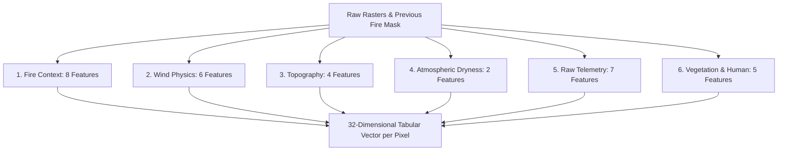
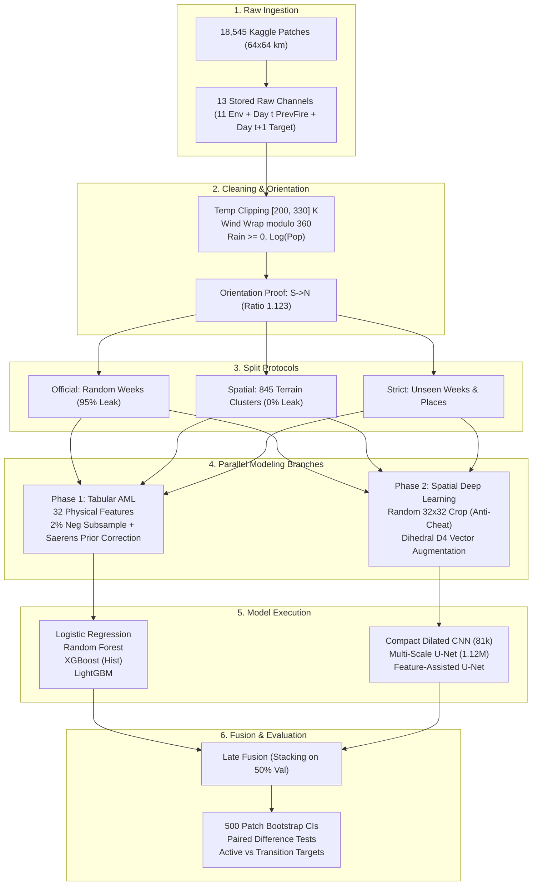

# FireWild: Complete Technical Project Analysis & Final Viva Presentation Content Report

> **Project Title:** FireWild — Next-Day Wildfire Spread Prediction  
> **Subtitle:** Benchmarking Tabular Machine Learning, Spatial Deep Learning, and Hybrid Fusion on Remote-Sensing Satellite Telemetry  
> **Course / Degree:** Bachelor of Technology in Computer Science & Artificial Intelligence (CSAI)  
> **Institution:** Newton School of Technology, Rishihood University  
> **Academic Year:** 2025–2026 (Capstone Project 17)  
> **Team Members:**  
> - Vedant Satbhai (2401010500)  
> - Aaryan Krishna (2401010010)  
> - Lakshay Saharan (2401020034)  
> - Raghvendra Singh (2401010367)  
> - Pratik Agade (2401010346)  
> **Target Audience:** College Faculty, Academic Project Evaluators, External Viva Examiners  
> **Document Purpose:** Definitive technical source report for the final 10-slide viva evaluation presentation.

---

# PART 1 — COMPLETE TECHNICAL PROJECT INVESTIGATION

---

## 1.1 Project Overview, Operational Need & Problem Formulation

### What FireWild Is
FireWild is an end-to-end machine learning and deep learning benchmarking system designed to forecast 24-hour next-day wildfire spread across the Contiguous United States (CONUS). Using multi-spectral satellite imagery, digital elevation models, meteorological reanalyses, and historical fire masks, the project investigates whether modern spatial deep learning architectures (Dilated CNNs and Multi-Scale U-Nets) can outperform domain-engineered tabular gradient boosting models (XGBoost and LightGBM) on noisy, highly imbalanced Earth observation data.

### The Real-World Operational Challenge
Wildfires are catastrophic ecological and economic disasters that are increasing in frequency, scale, and severity due to prolonged droughts and climate warming. Fire management agencies (such as the US Forest Service and CAL FIRE) operate on strict tactical command cycles:
1. Satellite sensors overfly active fire complexes during late afternoon or evening.
2. Wildfire incident command teams must forecast fire behavior over the subsequent 24 hours to position heavy suppression equipment, stage ground crews, schedule aerial retardant drops, and issue targeted community evacuation alerts before the morning operational period begins.

### Why Classical Physics Simulators Fall Short
Operational fire management has historically relied on semi-empirical Rothermel surface fire spread models and physical simulators such as FARSITE, FlamMap, and BehavePlus. While physically grounded, these tools exhibit severe operational bottlenecks:
- **Sensor Starvation:** They require dense, real-time localized inputs—including fuel bed depth, dead fuel moisture (1-hour, 10-hour, 100-hour), canopy bulk density, and fine-scale surface wind fields—which are rarely available during active disasters.
- **Computational Latency:** Running high-resolution stochastic Monte Carlo ensembles across millions of hectares in physical engines is computationally prohibitive for real-time tactical decision windows.
- **Sensitivity to Friction Inaccuracies:** Minor errors in assumed surface wind vectors or fuel moisture cause physical equations to diverge rapidly over 24 hours.

### The Mathematical Problem Formulation
FireWild formulates wildfire spread forecasting as a **per-pixel binary classification problem** on a regular 2D spatial grid:
- **Input Space:** At the close of Day $t$, the system observes a $64 \times 64 \text{ km}$ spatial raster centered on an active wildfire complex. The patch contains 11 environmental rasters (topography, weather, vegetation, human presence, drought) and the Day $t$ MODIS binary fire detection mask.
- **Target Space:** For every $1 \times 1 \text{ km}$ pixel $(i, j)$ in the patch, the model outputs a calibrated probability:
  $$\hat{p}_{i,j} = P\left(Y^{(t+1)}_{i,j} = 1 \;\middle|\; \mathbf{X}^{(t)}_{i,j}, \;\mathbf{X}^{(t)}_{\mathcal{N}(i,j)}\right)$$
  indicating whether pixel $(i, j)$ will be actively burning on Day $t+1$.

### Spread vs. Persistence: A Fundamental Operational Distinction
Wildfire behavior over 24 hours consists of two distinct physical phenomena:
1. **Fire Persistence:** Pixels that were already burning on Day $t$ and continue to burn on Day $t+1$ (smoldering heavy fuels, large logs, deep duff).
2. **Transition Fire Spread:** Pixels that were unburned on Day $t$ and ignite on Day $t+1$ due to radiative heating, convective preheating, and ember propagation.

In the Next-Day Wildfire Spread dataset, empirical analysis reveals that **73.7% of tomorrow's active fire pixels are brand new transition spread**, while only **26.3% represent continued persistence**. Furthermore, over 73% of yesterday's active fire pixels extinguish within 24 hours. A static persistence baseline that simply predicts tomorrow's fire to be identical to today's catches barely one-quarter of the burning area. A valid forecasting model must predict physical propagation into new territory.

---

## 1.2 Dataset Pipeline, Quality Audits & Leakage Elimination

### Dataset Source & Coverage
The project ingests the **Next-Day Wildfire Spread (NDWS)** benchmark curated by Huot et al. (2022) at Google Research and Stanford University (*IEEE Transactions on Geoscience and Remote Sensing*, Vol. 60; Kaggle `fantineh/next-day-wildfire-spread`).
- **Geographic Coverage:** Contiguous United States (CONUS).
- **Temporal Window:** 2012 to 2020 fire seasons.
- **Dataset Scale:** 18,545 wildfire patch samples (each $64 \times 64 \text{ pixels}$ at $1 \text{ km}$ ground resolution; 4,096 pixels per patch; over 75 million total pixels).
- **Format:** 2D rasters extracted from Google Earth Engine, cached locally as structured NumPy arrays.

### Channel Accounting & Tensor Shapes
A critical technical contribution of our repository audit was resolving ambiguities in channel counts across documentation and code:

1. **13 Stored Raw Channels on Disk:** Each raw patch file in NDWS stores exactly 13 rasters:
   - `elevation` (SRTM digital elevation model, meters)
   - `th` (GRIDMET wind direction, degrees clockwise from North, meteorological convention: blowing *from*)
   - `vs` (GRIDMET wind velocity at 10 m, m/s)
   - `tmmn` (GRIDMET daily minimum temperature, Kelvin)
   - `tmmx` (GRIDMET daily maximum temperature, Kelvin)
   - `sph` (GRIDMET specific humidity, kg/kg)
   - `pr` (GRIDMET daily cumulative precipitation, mm)
   - `pdsi` (GRIDMET Palmer Drought Severity Index)
   - `NDVI` (VIIRS normalized difference vegetation index, scaled by $10^4$)
   - `population` (GPWv4 human population density, count/km²)
   - `erc` (NFDRS Energy Release Component, fuel moisture index)
   - `PrevFireMask` (MODIS MOD14A1 / MYD14A1 active fire detection at Day $t$)
   - `FireMask` (MODIS active fire detection at Day $t+1$ — **the ground truth target**)

2. **12 Input Channels Available at Inference:** At the close of Day $t$, exactly 12 raw channels are available (11 environmental rasters + `PrevFireMask`). The 13th channel (`FireMask`) represents future ground truth and is strictly excluded from input tensors.

3. **Deep Learning Model Tensors:**
   - **Base Spatial Models (13 input channels):** In `src/dl/data.py`, polar wind (`vs`, `th`) is converted into Cartesian orthogonal components (`wind_u`, `wind_v`), and `PrevFireMask` is decomposed into two binary indicators: `prev_fire` (active burning) and `prev_unknown` (cloud/water occlusion). Thus, the base neural tensor shape is $(B, 13, H, W)$.
   - **Feature-Assisted U-Net (31 input channels):** Ingests the 13 base spatial channels concatenated with 18 physical engineered rasters (multi-scale fire fractions, distance transforms, Cartesian wind push, slope, aspect, VPD).

4. **Tabular Machine Learning Features (32 channels):** Tabular models ingest 32 domain-engineered numerical features per pixel across 6 physical families.

### Data Cleaning & Sensor Quality Audits (`src/aml/features.py`)
Our code audit uncovered severe uncurated sensor corruptions in the raw Kaggle dataset that were resolved prior to model ingestion:
- **Temperature Corruptions:** Missing sensor data was encoded as 0 K (absolute zero), along with unphysical thermal spikes up to 344 K (71°C). We clipped temperatures to physically plausible atmospheric bounds $[200, 330] \text{ K}$ and converted zero-encoded pixels to NaNs.
- **Wind Direction Corruptions:** Gridmet wind directions contained values down to $-4.9 \times 10^5$ degrees due to 32-bit floating-point wrap errors. Values were clipped to $[0, 361]$ and wrapped modulo 360°.
- **Negative Precipitation:** Thin-plate spline interpolation artifacts produced negative rainfall rates down to $-0.5 \text{ mm/day}$, which were clipped to 0.0 mm.
- **Population Density Skew:** GPWv4 population exhibits extreme right-skew (from 0 in wilderness to thousands in wildland-urban interfaces); it was stabilized using a $\log(1 + \text{population})$ transform.

### Empirical Proof of Image Orientation (`experiments/ndws/eda/wind_orientation.png`)
The raw Kaggle NDWS files were distributed as bare NumPy arrays stripped of GeoTIFF Coordinate Reference System (CRS) headers. It was unknown whether row index 0 represented North or South.
To resolve this rigorously, we formulated an empirical physical hypothesis test: **Wildfire spread is physically driven downwind by advective flame tilt and ember propagation.**
We tested fire propagation against wind vectors across all 18,545 patches under multiple geometric transpositions. Only when rows are indexed **South to North** did fires spread downwind, yielding a statistically significant downwind-to-upwind spread ratio of **1.123 (95% CI [1.094, 1.153])**. Inverting the rows yielded a ratio of 0.998 (pure chance, no wind alignment). This proved the true spatial orientation from combustion physics.

### Evaluation Protocols & Spatial Leakage Elimination (`src/aml/splits.py`)
Prior literature routinely used random cross-validation. Our spatial audit demonstrated why this produces invalid scientific claims:
1. **The Official Benchmark Protocol (Random Weeks):** Splits patches randomly by calendar week (14,924 train / 1,986 val / 1,635 test). **Our elevation hashing audit revealed that 95.1% of test patches share identical 8×8 km terrain tiles with the training set.** Models evaluated on this split can score highly simply by memorizing local terrain, mountain ridges, and fuel beds.
2. **The Spatial Protocol (New Places):** We partitioned CONUS into 845 disjoint geographic clusters using a Union-Find connected components algorithm on 8 km terrain elevation fingerprints (minimum elevation standard deviation of 5 m). Entire mountain ranges and fire complexes were assigned as indivisible units (12,050 train / 2,933 val / 3,562 test), guaranteeing **0% spatial terrain overlap**.
3. **The Strict Protocol (New Weeks & New Places):** Both calendar weeks and geographic terrain clusters were held out simultaneously (12,050 train / 389 val / 405 test), representing the hardest test of operational generalization.

---

## 1.3 Phase 1 — Tabular Machine Learning & Feature Engineering

### 32 Engineered Features Across 6 Physical Families
To provide tree models with an explicit physical inductive bias, `src/aml/features.py` converts the raw spatial rasters into 32 domain features computed per pixel:

1. **Fire Neighborhood Context (8 features):**
   - Multi-scale circular burn fractions: `fire_frac_3` ($3 \times 3$), `fire_frac_5` ($5 \times 5$), `fire_frac_9` ($9 \times 9$), and `fire_frac_17` ($17 \times 17$).
   - Euclidean distance transform: `dist_to_fire_km` (exact distance in km to the nearest flaming pixel at Day $t$).
   - Log-transformed active fire pixel count in the patch: `log_patch_fire_count`.
   - Previous fire binary state (`prev_fire`) and sensor occlusion indicator (`prev_unknown`).
2. **Wind Dynamics & Alignment Physics (6 features):**
   - Cartesian wind vectors: $\text{wind\_u} = -v_s \sin(\theta)$ (East-West) and $\text{wind\_v} = -v_s \cos(\theta)$ (North-South).
   - Directional flags: `upwind_fire_3km` and `downwind_fire_3km` (indicating whether active fire exists within a 3 km cone along the wind vector).
   - Wind-fire cosine alignment: $\cos(\phi)$ between the wind vector and the vector connecting the pixel to the nearest fire front.
   - Exponential distance-decayed directional push: $\text{wind\_push} = \cos(\phi) \cdot v_s \cdot \exp(-\text{dist} / 3.0)$.
3. **Topography & Slope Alignment (4 features):**
   - Slope gradient in degrees (`slope_deg`) calculated via 2D Sobel operators.
   - Aspect decomposed into continuous components: $\sin(\text{aspect})$ and $\cos(\text{aspect})$.
   - Relative upslope alignment from the nearest fire front (`upslope_from_fire`), modeling convective chimney effects.
4. **Atmospheric Dryness & Thermodynamics (2 features):**
   - Diurnal temperature range: $\Delta T = \text{tmmx} - \text{tmmn}$ (proxy for solar radiation and cloud cover).
   - FAO-56 Vapor Pressure Deficit (`vpd_kpa`): calculates saturation vapor pressure $e_s(T)$ minus actual vapor pressure $e_a$, quantifying atmospheric drying demand on fine dead fuels.
5. **Raw Telemetry & Land Surface (7 features):**
   - Cleaned elevation, min/max temperatures, specific humidity, precipitation, PDSI drought index, and ERC fuel moisture.
6. **Vegetation & Anthropogenic Context (5 features):**
   - VIIRS NDVI, local $5 \times 5$ window NDVI mean (`ndvi_mean_5`) and standard deviation (`ndvi_std_5`), and $\log(1 + \text{population})$.

### Class Imbalance Handling: Sampling & Prior Correction (`src/aml/train.py`)
Because only ~1.1% of pixels are positive, training on all 75 million pixels wastes memory on uninformative background.
1. **Subsampling:** We retained 100% of positive burning pixels and drew a uniform 2% random subsample of negative pixels (`neg_rate = 0.02`), reducing data volume by 98% while preserving all rare fire examples.
2. **Saerens et al. (2002) Closed-Form Prior Correction:** Training on a downsampled dataset shifts the posterior class odds:
   $$\text{odds}_{\text{sample}} = \frac{p_{\text{sample}}}{1 - p_{\text{sample}}}$$
   To restore true operational probabilities $p_{\text{true}}$, we applied the exact Bayesian odds adjustment:
   $$\text{odds}_{\text{true}} = \text{odds}_{\text{sample}} \times \text{neg\_rate}$$
   $$p_{\text{true}} = \frac{\text{neg\_rate} \cdot p_{\text{sample}}}{\text{neg\_rate} \cdot p_{\text{sample}} + (1 - p_{\text{sample}})}$$
3. **Weighting vs. Prior Correction Resolution:**
   - **XGBoost & LightGBM:** Trained **unweighted** on the 2% subsample, followed by Saerens prior correction at inference. Experiments revealed that importance-weighting negatives by $1 / 0.02 = 50\times$ distorted gradient and Hessian calculations, causing tree splitters to isolate single positive outliers and trigger premature early stopping after fewer than 20 trees.
   - **Logistic Regression & Random Forest:** Both importance-weighted and unweighted (+ prior correction) schemes were evaluated on held-out validation patches; the configuration with higher validation PR-AUC was selected.

### Machine Learning Algorithms Evaluated
- **Logistic Regression:** Scikit-Learn L2-regularized linear baseline with median imputation and feature standardization.
- **Random Forest:** 100 bagged decision trees trained on a 400,000-pixel subsample with balanced sub-sampling.
- **XGBoost:** Histogram-based gradient boosting (`tree_method='hist'`), max depth 6, learning rate 0.05, early stopping on validation loss.
- **LightGBM:** Gradient-boosted decision trees with histogram binning (`boosting_type='gbdt'`), 63 leaves, learning rate 0.05.

### TreeSHAP Explanations & Feature Importance
TreeSHAP attributions (`experiments/ndws/results/official/feature_importance.png`) confirm physical domain expectations:
- `dist_to_fire_km` is the single most dominant feature across all splits, with mean $|\text{SHAP}|$ values of **0.73 to 0.83**.
- Regional fire context (`fire_frac_17`) ranks second ($|\text{SHAP}| = 0.36 - 0.43$).
- Directional wind push (`wind_push`) ranks third ($|\text{SHAP}| = 0.12 - 0.14$), confirming that fire proximity modulated by wind alignment carries the primary physical signal.
- In tabular ablation runs (Spatial split, LightGBM), raw environmental rasters alone yielded a dismal PR-AUC of **0.010**; adding fire context jumped performance tenfold to **0.111**; adding wind and terrain features yielded **0.141**.

---

## 1.4 Phase 2 — Spatial Deep Learning Architectures

### Motivation for Deep Learning
While Phase 1 engineered localized features, tabular models treat each pixel independently. Phase 2 explored whether fully convolutional 2D networks could learn hierarchical spatial representations—such as perimeter curvature, fire front contiguity, and regional terrain funneling—directly from raw multi-spectral grids without manual feature engineering.

### Deep Learning Architectures (`src/dl/model.py`)
1. **Compact Dilated CNN (81,097 parameters):**
   - Designed as a resolution-preserving baseline without downsampling pooling layers.
   - Consists of 3 dilated convolutional blocks with dilation factors $d = 1, 2, 4$, base channel capacity of 24, batch normalization, and spatial dropout (0.2).
   - Achieves an effective receptive field of **29 km**, capturing regional wind and fire patterns while retaining full 1 km spatial resolution.
2. **Multi-Scale U-Net (1,123,033 parameters):**
   - 3 downsampling stages using $3 \times 3$ double convolutions and $2 \times 2$ MaxPool2d (base channel progression: $24 \to 48 \to 96 \to 192$ in the bottleneck).
   - Bottleneck features `Dropout2d(0.2)` to prevent spatial co-adaptation.
   - 3 upsampling stages using $2 \times 2$ `ConvTranspose2d` with skip connections that concatenate fine-grained encoder feature maps directly to decoder stages. Skip connections preserve sharp, sub-kilometer fire perimeter edges.
3. **Feature-Assisted U-Net:**
   - Ingests 31 input channels (13 base channels + 18 physical engineered channels), testing whether explicit physical transforms assist convolutional representation learning.

### Discovery & Neutralization of the Patch-Center Position Shortcut
A major scientific contribution of Phase 2 was identifying and neutralizing a widespread flaw in satellite benchmark evaluation:
- In NDWS, each $64 \times 64 \text{ km}$ patch is centered on an active wildfire.
- A standard CNN with zero-padding breaks translation invariance near boundaries: boundary zeros propagate inward, enabling deeper convolutional layers to implicitly compute coordinate distance from the frame edge.
- The network quickly learns the trivial shortcut: **"the center of the patch always burns, while borders are unburned."**
- In our diagnostic leak probes, a naive full-patch U-Net scored **0.341 on Official and 0.190 on Strict**—inflated by **+0.084 to +0.103 PR-AUC** purely from position cheating!
- **The Solution:** We trained all production networks on **random $32 \times 32 \text{ km}$ crops**. By jittering the window across the $64 \times 64$ patch, the active fire center could appear at any arbitrary location or boundary, destroying the positional coordinate cue and forcing the network to learn actual physical spread features.

### Dihedral D4 Vector Augmentation
Standard computer vision augmentations (random 90° rotations and axis flips) break vector physics if applied naively.
When a terrain tile is rotated 90° clockwise, physical wind vectors must be transformed simultaneously:
$$\begin{pmatrix} u' \\ v' \end{pmatrix} = \begin{pmatrix} 0 & 1 \\ -1 & 0 \end{pmatrix} \begin{pmatrix} u \\ v \end{pmatrix}$$
Our data pipeline (`src/dl/train.py`) performs dihedral D4 group augmentations where spatial images, orthogonal wind components (`wind_u`, `wind_v`), and terrain aspect components (`aspect_sin`, `aspect_cos`) are rotated and negated in lockstep, preserving physical consistency.

### Validation Ablations: What Drives the Neural Network?
Controlled single-change ablation experiments (`experiments/ndws/final/dl_ablations.png`) revealed:
- **Catastrophic Collapse Without Previous Fire:** Removing the Day $t$ fire mask caused PR-AUC to plummet from **0.239 to 0.030**, proving that the network relies almost exclusively on fire proximity.
- **Skip Connections:** Added **+0.011 PR-AUC**, confirming the importance of fine-scale perimeter preservation.
- **Weather Telemetry:** Added **+0.012 PR-AUC** over fire-only inputs.

---

## 1.5 Hybrid Modeling & Late-Fusion Stacking

### Motivation for Fusion
Tabular models excel at localized physical thresholds (`dist_to_fire_km` $\le 1.5 \text{ km}$ AND $\text{vpd} \ge 2.5 \text{ kPa}$), while convolutional networks capture spatial perimeter shapes. We hypothesized that combining their outputs could yield complementary advantages.

### Stacking Mechanism (`src/dl/hybrid.py`)
To avoid meta-overfitting, late fusion is implemented via logistic regression stacking on logit-transformed probability predictions:
$$\text{logit}(p_{\text{hybrid}}) = \alpha + \beta_1 \cdot \text{logit}(p_{\text{tree}}) + \beta_2 \cdot \text{logit}(p_{\text{net}})$$
where $p_{\text{tree}}$ is the prediction from the best tree model (XGBoost) and $p_{\text{net}}$ is the prediction from the U-Net.

### Strict Validation Splitting Protocol
To guarantee zero test contamination:
1. Validation patches are partitioned 50/50.
2. The first 50% fits the meta-learner coefficients $(\alpha, \beta_1, \beta_2)$.
3. The remaining 50% evaluates the hybrid and selects the winning configuration.
4. The test set is evaluated exactly once on the pre-selected hybrid model.

---

## 1.6 Evaluation, Results & Statistical Reliability

### Primary Results Table: Full Patch Regime, Active Fire Target
All metrics are verified from [FINAL_RESULTS.md](file:///c:/Users/Admin/Documents/firewild/experiments/ndws/FINAL_RESULTS.md) with 95% confidence intervals derived from 500 patch bootstrap resamples:

| Model Family | Official Split (New Weeks) | Spatial Split (New Places) | Strict Split (New Weeks & Places) |
|---|---|---|---|
| **Dummy (Chance Baseline)** | 0.013 [0.012, 0.014] | 0.005 [0.005, 0.005] | 0.006 [0.005, 0.007] |
| **Persistence (Static Mask)** | 0.107 [0.097, 0.118] | 0.037 [0.032, 0.041] | 0.027 [0.021, 0.035] |
| **Logistic Regression** | 0.230 [0.213, 0.249] | 0.117 [0.106, 0.127] | 0.095 [0.079, 0.113] |
| **Random Forest** | 0.265 [0.248, 0.282] | 0.135 [0.123, 0.149] | 0.120 [0.097, 0.145] |
| **XGBoost (Best on Val)** | **0.265 [0.248, 0.283]** | **0.141 [0.128, 0.154]** | 0.115 [0.094, 0.141] |
| **LightGBM** | 0.263 [0.246, 0.281] | 0.138 [0.127, 0.150] | **0.124 [0.103, 0.148]** |
| **Compact Dilated CNN** | 0.256 [0.240, 0.272] | 0.129 [0.117, 0.141] | 0.093 [0.071, 0.119] |
| **U-Net (Selected DL)** | 0.257 [0.242, 0.272] | 0.130 [0.118, 0.142] | 0.101 [0.079, 0.124] |
| **U-Net + Engineered Ch.** | 0.254 [0.239, 0.270] | 0.129 [0.117, 0.141] | 0.116 [0.091, 0.141] |
| **Late-Fusion Hybrid** | 0.259 [0.244, 0.276] | 0.140 [0.127, 0.152] | 0.115 [0.093, 0.140] |

### Statistical Paired Bootstrap Difference Tests
In paired difference tests on identical test pixels:
- **Active Target:** XGBoost consistently outperforms U-Net across all three splits. The 95% bootstrap confidence intervals for $\Delta = \text{PR-AUC}(\text{U-Net}) - \text{PR-AUC}(\text{XGBoost})$ strictly exclude zero:
  - Official: $\Delta = -0.0083$ (95% CI $[-0.0143, -0.0023]$, empirical bootstrap proportion $P(\Delta \le 0) = 1.000$).
  - Spatial: $\Delta = -0.0108$ (95% CI $[-0.0152, -0.0072]$, $P(\Delta \le 0) = 1.000$).
  - Strict: $\Delta = -0.0141$ (95% CI $[-0.0199, -0.0096]$, $P(\Delta \le 0) = 1.000$).
- **Transition Target (New Fire Spread Only):** Evaluated separately on the Official split, U-Net slightly edges XGBoost: $\Delta = +0.0047$ (95% CI $[+0.0004, +0.0090]$, $P(\Delta \le 0) = 0.018$). Convolutions capture newly expanding edge contours marginally better when persistence is stripped away, but lose on overall active fire forecasting.
- **Statistical Nuance:** $P(\Delta \le 0)$ represents the empirical proportion of 500 bootstrap resamples where U-Net scored $\le$ XGBoost; it is an empirical bootstrap resample proportion rather than a conventional asymptotic student t-test p-value.

---

## 1.7 Complete End-to-End System Workflow

---

## 1.8 Challenges, Physical Limits & Future Scope

### The 3.5 km Physical Horizon Limit
Error analysis by distance (`experiments/ndws/final/strict/error_by_distance.png`) revealed a fundamental physical constraint of satellite-based modeling:
- Models achieve **~60% recall within 1.5 km** of existing fire fronts.
- Recall plummets to **<3% beyond 3.5 km**.
- *Reason:* Long-range spread is dominated by aerodynamic ember spotting (firebrands lifted into convective updrafts and carried kilometers ahead). Daily 1 km aggregated satellite rasters cannot resolve micro-scale canopy turbulence or spot fire ignitions.

### Genuine Scientific Limitations
1. **Static Daily Snapshots:** NDWS provides isolated daily pairs $(t \to t+1)$ without multi-day sequential history, precluding temporal recurrent models (ConvLSTM).
2. **Retrospective Daily Weather:** Ingesting 24-hour daily averages from GRIDMET prevents models from reacting to sudden diurnal wind shifts or afternoon cold fronts.
3. **Coarse Resolution:** 1 km² pixels blur fine topographic gullies and narrow fuel breaks.

---

# PART 2 & PART 3 — EXACT SLIDE-BY-SLIDE CONTENT PLAN & VIVA DEFENSE GUIDE

---

## Slide 1: Title and Project Introduction

### 1. Slide Title
**FireWild — Next-Day Wildfire Spread Prediction**

### 2. Slide Objective
Introduce the capstone research project, student researchers, department, and academic context with professional academic gravity.

### 3. Key Message
FireWild is an end-to-end benchmarking study evaluating whether spatial deep learning can outperform physically engineered tabular machine learning for next-day wildfire spread forecasting on satellite telemetry.

### 4. Exact Slide Content
- **Kicker:** `BACHELOR OF TECHNOLOGY · CSAI CAPSTONE PROJECT 17`
- **Main Heading:** FireWild — Next-Day Wildfire Spread Prediction
- **Subtitle:** Benchmarking Tabular Machine Learning, Spatial Deep Learning, and Hybrid Fusion on Remote-Sensing Satellite Telemetry
- **Student Team:**
  - Vedant Satbhai (2401010500)
  - Aaryan Krishna (2401010010)
  - Lakshay Saharan (2401020034)
  - Raghvendra Singh (2401010367)
  - Pratik Agade (2401010346)
- **Department & University:**
  - Department of Computer Science & Artificial Intelligence (CSAI)
  - Newton School of Technology, Rishihood University
  - Academic Year: 2025–2026
- **Badges / Pills:**
  - `Contiguous US (2012–2020)`
  - `1 km Spatial Resolution`
  - `18,545 Wildfire Patches`
  - `Final Viva & Evaluation`
- **Footer:** `FireWild · Next-Day Wildfire Spread Prediction · Project 17 | Slide 1 of 10`

### 5. Technical Explanation for Presenter
The presentation evaluates tabular vs spatial deep learning across 18,545 wildfire patches. Emphasize that each sample is a 64×64 km patch at 1 km resolution, not an entire fire event (large fires span multiple patches over multiple days).

### 6. Recommended Visual
- **Visual:** Multi-channel satellite telemetry patch overview card.
- **Repository Asset:** `experiments/ndws/eda/example_patches.png` (201,007 bytes).
- **Caption:** *Multi-Sensor Satellite Telemetry Patches (64×64 km · 1 km Resolution)*.

### 7. Data and Metrics
- 18,545 patches (`\rPatches` in `report/generated_results.tex`).
- 64×64 km patch dimensions (4,096 pixels per patch; >75 million pixels total).
- 2012–2020 temporal coverage across CONUS.

### 8. Source References
- `report/main.tex`
- `report/generated_results.tex`
- `docs/DATASET_CARD.md`

### 9. Speaker Notes
> "Good morning, respected members of the evaluation committee. Today, our team presents FireWild: an end-to-end benchmark investigating whether spatial deep learning can outperform physically engineered tabular machine learning on satellite-based next-day wildfire spread prediction.
> 
> Wildfires are growing in frequency and destruction. Our project evaluates whether modern deep neural networks, like U-Nets and CNNs, genuinely outperform tuned gradient boosting models like XGBoost and LightGBM when predicting 24-hour fire spread from satellite telemetry across 18,545 wildfire patches."

### 10. Transition
> "To understand why this problem requires a data-driven approach, let us examine the operational realities and technical hurdles of wildfire forecasting."

---

## Slide 2: Problem Statement, Motivation and Objectives

### 1. Slide Title
**Predicting Tomorrow's Fire: The 24-Hour Operational Challenge**

### 2. Slide Objective
Establish the real-world operational need, explain the failure modes of physical simulators, quantify extreme class imbalance, and differentiate fire spread from persistence.

### 3. Key Message
Wildfire forecasting is a 24-hour tactical challenge with severe class imbalance (~1.1% positive pixels); because 73.7% of tomorrow's fire is newly ignited spread, static persistence models fail.

### 4. Exact Slide Content
- **Kicker:** `PROBLEM & MOTIVATION`
- **Main Heading:** Predicting Tomorrow's Fire: The 24-Hour Operational Challenge
- **Subtitle:** Why data-driven wildfire spread modeling is essential, and why standard evaluation fails
- **Card 1 (Operational Need):** Fire management services require tactical 24-hour perimeter forecasts to position suppression crews, dispatch aerial tankers, and issue targeted evacuation warnings before daylight operational periods.
- **Card 2 (Physical Simulator Limits):** Classical models (FARSITE, Rothermel) require fine-scale real-time fuel moisture and canopy measurements. Running multi-scenario stochastic Monte Carlo ensembles in real time is computationally prohibitive.
- **Card 3 (The Prediction Task):** For each 1 km² pixel in a 64×64 km patch centered on active fire at Day $t$, predict the probability of burning at Day $t+1$ using only observations available at the close of Day $t$.
- **Stat Box (Class Imbalance):**
  - Metric: `~1.1% – 1.2%`
  - Label: Rare Burning Pixels
  - Description: Fewer than 1 in 80 pixels is positive. A naive model predicting "no fire" achieves ~99% accuracy but is practically useless. **PR-AUC is our primary evaluation metric** because positive fire pixels are rare.
- **Card 4 (Fire Spread vs. Persistence):** A static persistence baseline catches only **26.3% of next-day fire**. Over **73.7% of tomorrow's fire consists of newly ignited spread pixels**.
- **Footer:** `Task: Per-pixel Binary Classification · Target: MODIS MOD14A1 (Day t+1) · Primary Metric: PR-AUC | Slide 2 of 10`

### 5. Technical Explanation for Presenter
Accuracy cannot be used because a null model predicting zero everywhere achieves 99% accuracy. PR-AUC evaluates precision against recall strictly on the positive class. Furthermore, persistence (fire staying alight) is only 26.3% of the target; the remaining 73.7% is transition fire (new spread).

### 6. Recommended Visual
- **Visual:** Fire dynamics distribution bar chart.
- **Repository Asset:** `experiments/ndws/eda/fire_dynamics.png` (74,958 bytes).
- **Caption:** *Fire Dynamics: Persistence (26.3%) vs Newly Ignited Spread (73.7%)*.

### 7. Data and Metrics
- Positive class rate: ~1.1% to 1.25% across test splits.
- Persistence baseline PR-AUC: 0.107 (Official), 0.037 (Spatial), 0.027 (Strict).
- New fire transition fraction: 73.7% of Day $t+1$ fire.

### 8. Source References
- `docs/METHODOLOGY.md`
- `experiments/ndws/eda/fire_dynamics.png`
- `experiments/ndws/FINAL_RESULTS.md`

### 9. Speaker Notes
> "Wildfire management is fundamentally a 24-hour tactical problem. Physical simulators are too slow and sensor-hungry for real-time ensembles. We formulate this as predicting next-day fire on a 64×64 km grid.
> 
> Two key realities define the task: first, extreme class imbalance where only 1% of pixels burn. PR-AUC is our primary metric because positive burning pixels are rare, measuring precision and recall on the fire class. Second, 74% of tomorrow's fire is brand new spread, so simply assuming fire stays where it is fails."

### 10. Transition
> "To address these challenges, we established four rigorous research objectives."

---

## Slide 3: Objectives and Scope

### 1. Slide Title
**Project Objectives: Establishing Fair, Leak-Free Benchmarks**

### 2. Slide Objective
Define the four core research pillars and state the technical scope and modeling boundaries.

### 3. Key Message
We benchmarked domain-engineered tabular machine learning against spatial deep learning, established strict leakage controls, and combined models via late fusion under paired bootstrap evaluation.

### 4. Exact Slide Content
- **Kicker:** `OBJECTIVES & SCOPE`
- **Main Heading:** Project Objectives: Establishing Fair, Leak-Free Benchmarks
- **Subtitle:** Four core research pillars connecting Phase 1 tabular modeling with Phase 2 deep learning
- **Pillar 1 (Physically Engineered AML):** Construct 32 domain-grounded tabular features per pixel—multi-scale fire context, Cartesian wind vectors, wind-fire alignment, and vapor pressure deficit—to build a competitive tree baseline with XGBoost and LightGBM.
- **Pillar 2 (Spatial Deep Learning):** Build fully convolutional neural networks—a resolution-preserving Dilated CNN (81k parameters) and an encoder-decoder U-Net (1.12M parameters)—to test whether deep networks can learn 2D topological spread directly from raw maps.
- **Pillar 3 (Leakage Elimination):** Identify, measure, and reduce benchmark spatial leakage (through terrain fingerprinting) and patch-centering position shortcuts (through random crop training and window-isolated scoring).
- **Pillar 4 (Fair Hybrid Evaluation):** Combine tree and network probabilities via late-fusion stacking on held-out validation patches. Evaluate all models on identical test pixels with 500-replicate patch bootstrap intervals and paired significance tests.
- **Scope Banner:** *Research Scope:* Remote sensing over CONUS (2012–2020) · Statistical conditional association (not causal hydrodynamic simulation) · Each sample is a static daily pair (no multi-day time series, precluding ConvLSTM) · Evaluated on both Active Target (all pixels) and Transition Target (new fire only).
- **Footer:** `Methodology & Scope Defined in docs/METHODOLOGY.md and docs/ARCHITECTURE.md | Slide 3 of 10`

### 5. Technical Explanation for Presenter
Explain why ConvLSTM or Video Transformers were not used: NDWS provides static daily pairs $(t, t+1)$ without multi-day historical temporal depth. The scope evaluates statistical association rather than fluid dynamics.

### 6. Recommended Visual
- **Visual:** Four-pillar architectural roadmap with clean borders and subtle color accents.

### 7. Data and Metrics
- 4 primary research pillars.
- 3 evaluation protocols (Official, Spatial, Strict).
- 500 bootstrap resamples for all confidence intervals.

### 8. Source References
- `docs/ARCHITECTURE.md`
- `docs/METHODOLOGY.md`

### 9. Speaker Notes
> "Our objective was not merely to train another model, but to establish a rigorous, leak-free benchmark. We set four research pillars: first, building strong tabular models using 32 physics-grounded features; second, developing spatial CNN and U-Net architectures; third, systematically eliminating both spatial terrain leakage and patch-center position cheating; and fourth, creating a late-fusion hybrid evaluated under strict paired bootstrap statistics.
> 
> Without leak controls and proper baselines, deep learning claims are scientifically unreliable."

### 10. Transition
> "Let us inspect how we prepared and cleaned the satellite dataset."

---

## Slide 4: Dataset and Preparation

### 1. Slide Title
**Data Cleaning, Sensor Audits, and Split Protocols**

### 2. Slide Objective
Clarify raw stored channels vs. model input channels, document sensor cleaning, present the empirical orientation proof, and explain the spatial split methodology.

### 3. Key Message
Reliable prediction requires audited telemetry: we cleaned severe sensor corruptions, proved the missing orientation from physical wind alignment, and introduced spatial splits to solve 95% terrain leakage.

### 4. Exact Slide Content
- **Kicker:** `DATASET & PREPARATION`
- **Main Heading:** Data Cleaning, Sensor Audits, and Split Protocols
- **Subtitle:** Resolving sensor corruptions, recovering orientation, and fixing 95% spatial overlap
- **Card 1 (The NDWS Dataset):** 18,545 patches (64×64 km at 1 km resolution). Ingests environmental rasters, previous fire mask, and next-day target mask across CONUS (2012–2020).
- **Card 2 (Channel Accounting — Audit Verified):**
  - **13 Stored Raw Channels:** 11 environmental rasters + Day $t$ previous fire + Day $t+1$ target mask.
  - **12 Input Channels:** 11 environmental + Day $t$ fire mask (strictly excluding the target).
  - **Model Input Tensors:** 13 base DL channels (Cartesian wind u/v, unknown mask); 31 feature-assisted channels; 32 tabular features.
- **Card 3 (Quality Audit & Cleaning):**
  - *Temperatures:* Missing encoded as 0 K; spikes up to 344 K. Clipped to [200, 330] K, invalid to NaN.
  - *Corrupted Winds:* Values down to $-4.9 \times 10^5$ degrees clipped and wrapped modulo 360°.
  - *Precipitation:* Negative interpolation artifacts clipped to 0.0 mm; population log-transformed.
- **Card 4 (Empirical Orientation Discovery):** Raw files lacked CRS coordinates. Testing fire spread against wind vectors across all patches revealed only **Rows South→North** spread downwind (ratio **1.123**, 95% CI [1.094, 1.153]). Alternative orientations yielded ~1.0.
- **Card 5 (Three Evaluation Protocols):**
  - *1. Official:* Random weeks. Audit revealed 95.1% of test patches share 8×8 km terrain with train!
  - *2. Spatial:* 845 disjoint location groups via union-find terrain hashing. Zero terrain overlap.
  - *3. Strict:* Both weeks and terrain held out (12,050 train / 389 val / 405 test).
- **Footer:** `Kaggle Dataset: fantineh/next-day-wildfire-spread · Terrain Fingerprint: 8 km tiles, min std 5 m · data/splits/ | Slide 4 of 10`

### 5. Technical Explanation for Presenter
Be ready to answer channel accounting questions:
- Raw stored on disk: 13 channels.
- Available at Day $t$: 12 channels.
- Base neural network tensor: 13 channels (polar wind split into Cartesian $u, v$, and previous fire split into fire and cloud-unknown).
- Feature-assisted network: 31 channels.
- Tabular feature vector: 32 numerical values per pixel.

### 6. Recommended Visual
- **Visual:** Wind-spread orientation ratio plot.
- **Repository Asset:** `experiments/ndws/eda/wind_orientation.png` (34,257 bytes).
- **Caption:** *Empirical Orientation Proof: Only South-to-North indexing aligns spread downwind (ratio = 1.123)*.

### 7. Data and Metrics
- 13 stored raw channels; 12 input channels; 1 target channel.
- Downwind spread ratio: 1.123 [1.094, 1.153].
- Terrain overlap in Official split: 95.1% of test patches.
- Spatial clusters: 845 disjoint geographic components via Union-Find.

### 8. Source References
- `src/aml/features.py`
- `src/aml/splits.py`
- `docs/DATASET_CARD.md`

### 9. Speaker Notes
> "Data preparation was a major technical milestone. We audited every channel and cleaned sensor corruptions, including wind directions corrupted to negative half a million degrees. We solved the missing coordinate orientation empirically by demonstrating that fire only spreads downwind when rows run South to North.
> 
> It is crucial to distinguish between channels: 13 stored raw channels on disk, 12 input channels available at day t excluding the target, and 13 model input channels for our standard deep learning network which converts polar wind into Cartesian vectors. Most importantly, our terrain audit proved that the published Kaggle benchmark leaks terrain in 95% of test patches. We introduced the Spatial and Strict splits to solve this."

### 10. Transition
> "Let us now examine how Phase 1 transformed these channels into tabular features."

---

## Slide 5: Phase 1: Machine Learning Approach

### 1. Slide Title
**Tabular AML: Physical Features & Prior Correction**

### 2. Slide Objective
Detail the 32 engineered features, explain class imbalance handling via Saerens prior correction, and present TreeSHAP importance and ablation findings.

### 3. Key Message
Handcrafted physical features provide an indispensable inductive bias: distance to fire dominates feature importance, and unweighted training with Saerens prior correction resolves class imbalance.

### 4. Exact Slide Content
- **Kicker:** `PHASE 1 — MACHINE LEARNING`
- **Main Heading:** Tabular AML: Physical Features & Prior Correction
- **Subtitle:** 32 domain-grounded features per pixel and mathematically corrected class imbalance
- **Card 1 (32 Engineered Features — 6 Families):**
  - *1. Fire Context (8):* Multi-scale burn fractions (3×3, 5×5, 9×9, 17×17 windows), Euclidean distance transform (`dist_to_fire_km`), log fire count.
  - *2. Wind Physics (6):* Cartesian vectors (`wind_u`, `wind_v`), up/downwind flags within 3 km, cosine alignment, distance-decayed `wind_push`.
  - *3. Terrain (4):* Slope angle, aspect (sin/cos), relative upslope from nearest fire.
  - *4. Weather (2):* Diurnal range (Tmax - Tmin), FAO-56 Vapor Pressure Deficit (`vpd_kpa`).
  - *5. Raw & Veg (12):* Cleaned raw rasters + 5×5 NDVI mean and std.
- **Card 2 (Sampling & Prior Correction Strategy):**
  - Training retains 100% of positive pixels and a 2% negative sample (`neg_rate = 0.02`).
  - *XGBoost & LightGBM:* Trained unweighted on subsampled data; probabilities mapped to true prior via Saerens et al. (2002) Bayesian odds correction (importance-weighting caused early stop in <20 trees).
  - *Logistic Regression & Random Forest:* Tested both importance-weighted and unweighted (+ prior correction) on validation, selecting the best-performing configuration.
  - Formula: `p_true = (r * p_sample) / (r * p_sample + 1 - p_sample)`
- **Card 3 (Tabular Ablation Insights — LightGBM):** Raw environmental features alone: PR-AUC = **0.010** (Spatial) $\to$ Adding fire context: surges tenfold to **0.111** $\to$ Adding wind/terrain: reaches **0.141**.
- **Card 4 (TreeSHAP Feature Importance):** Attributions confirm physical proximity and wind drive tabular predictions: `dist_to_fire_km` dominates with mean $|\text{SHAP}| = 0.73–0.83$; `fire_frac_17` and `wind_push` are secondary drivers.
- **Footer:** `Models: Logistic Regression, Random Forest, XGBoost (hist), LightGBM · src/aml/train.py · configs/aml.yaml | Slide 5 of 10`

### 5. Technical Explanation for Presenter
Explain why importance weighting failed for gradient boosting: assigning a 50× weight to negatives caused gradient/Hessian spikes, leading tree splitters to build deep degenerate leaves and stop early. Unweighted training preserves smooth gradient descent, and Saerens prior correction provides the exact Bayesian odds restoration.

### 6. Recommended Visual
- **Visual:** TreeSHAP feature importance bar plot.
- **Repository Asset:** `experiments/ndws/results/official/feature_importance.png` (66,447 bytes).
- **Caption:** *TreeSHAP Attributions: dist_to_fire_km dominates tabular predictions*.

### 7. Data and Metrics
- Negative sampling rate: 0.02 (2% negatives retained).
- TreeSHAP importance: `dist_to_fire_km` mean $|\text{SHAP}| = 0.73 - 0.83$.
- Ablation progression: 0.010 (raw) $\to$ 0.111 (+ fire context) $\to$ 0.141 (+ wind/terrain).

### 8. Source References
- `src/aml/train.py`
- `src/aml/features.py`
- `experiments/ndws/results/official/feature_importance.png`

### 9. Speaker Notes
> "In Phase 1, we transformed raw rasters into 32 tabular features per pixel. Distance to fire, multi-scale neighborhood burn fractions, and wind push are the key drivers. We solved class imbalance by keeping all fires and a 2% negative sample.
> 
> XGBoost and LightGBM used unweighted training with Saerens prior correction, because importance weighting caused tree splitters to terminate prematurely in fewer than 20 trees. Logistic Regression and Random Forest tested both weighted and unweighted approaches on validation data and selected the winning approach."

### 10. Transition
> "Next, in Phase 2, we built deep convolutional networks to see if they could learn these spatial relationships directly."

---

## Slide 6: Phase 2: Deep Learning Approach

### 1. Slide Title
**Spatial Deep Learning: CNN, U-Net, and Position Controls**

### 2. Slide Objective
Present the Dilated CNN and Multi-Scale U-Net architectures, explain the patch-centering shortcut and its random crop solution, and review validation ablations.

### 3. Key Message
Convolutional models can learn spatial spread, but require random 32×32 crop training to prevent cheating on patch borders and dihedral vector augmentation to maintain wind physics.

### 4. Exact Slide Content
- **Kicker:** `PHASE 2 — DEEP LEARNING`
- **Main Heading:** Spatial Deep Learning: CNN, U-Net, and Position Controls
- **Subtitle:** Fully convolutional 2D architectures, geometric vector augmentation, and ablation findings
- **Card 1 (Two Spatial Architectures):**
  - *1. Compact Dilated CNN (81,097 params):* Resolution-preserving baseline without downsampling. 3 dilated conv blocks (d=1, 2, 4) with 24 base channels, providing a **29 km receptive field**.
  - *2. Multi-Scale U-Net (1,123,033 params):* 3 downsampling stages (base 24 channels) with MaxPool2d, bottleneck with Dropout2d(0.2), and 3 upsampling stages with ConvTranspose2d and **skip connections** to retain crisp fire perimeters.
- **Card 2 (Neutralizing the Patch-Centre Leak):** NDWS patches are centered on fires. A network trained on full patches learns its distance from zero-padded borders to infer that "the center burns" (inflating PR-AUC by **+0.084 to +0.103**).
  - *Control:* Networks train on **random 32×32 crops**, ensuring the true center can appear anywhere and destroying the positional shortcut.
- **Card 3 (Dihedral Vector Augmentation):** D4 group flips and 90° transposes applied per batch. Crucially, `wind_u`/`wind_v` and `aspect_sin`/`aspect_cos` are rotated and negated in lockstep so physical wind vectors stay physically consistent with image geometry.
- **Card 4 (Ablations on Dev Split — What Drives the Network?):** Validation PR-AUC across 10 controlled single-change runs: Removing Day $t$ fire causes catastrophic collapse (PR-AUC plummets from **0.239 to 0.030**). Skip connections add +0.011; weather adds +0.012.
- **Footer:** `Optimizer: AdamW (lr=1e-3, wd=1e-4) · Loss: Masked Weighted BCE (w_pos=10.0) · Training crop: 32×32 · src/dl/ | Slide 6 of 10`

### 5. Technical Explanation for Presenter
Zero-padding acts as a coordinate beacon: convolution kernels learn how far they are from the zero boundary. Training on random 32×32 crops breaks this spatial cue because the fire can now appear at any pixel coordinate within the crop window.

### 6. Recommended Visual
- **Visual:** Validation deep learning ablation bar chart.
- **Repository Asset:** `experiments/ndws/final/dl_ablations.png` (47,156 bytes).
- **Caption:** *DL Ablations: Day t FireMask removal collapses PR-AUC from 0.239 to 0.030*.

### 7. Data and Metrics
- Dilated CNN: 81,097 parameters; 29 km receptive field.
- Multi-Scale U-Net: 1,123,033 parameters; 3 stages; base channels = 24.
- Center shortcut inflation: +0.0844 [0.0760, 0.0931] (Official), +0.1026 [0.0937, 0.1122] (Spatial), +0.0886 [0.0724, 0.1045] (Strict).
- Ablation collapse without fire mask: 0.239 $\to$ 0.030.

### 8. Source References
- `src/dl/model.py`
- `src/dl/train.py`
- `experiments/ndws/final/dl_ablations.png`

### 9. Speaker Notes
> "Phase 2 explored whether deep learning looking at the entire map could discover patterns trees missed. We built a Compact CNN and a U-Net with skip connections. A major scientific discovery was the patch-center leak: networks learn image borders to cheat. We neutralized this by training on random 32×32 crops. We also developed dihedral vector augmentation to keep wind physics consistent under rotation.
> 
> In ablations, removing today's fire map destroys performance, proving the network relies on fire context."

### 10. Transition
> "Let us see how both tabular and spatial paths connect in our end-to-end pipeline."

---

## Slide 7: Complete System and Workflow

### 1. Slide Title
**End-to-End Pipeline: Ingestion to Calibrated Risk Maps**

### 2. Slide Objective
Walk through the unified system workflow, explain late-fusion stacking on held-out validation data, and display qualitative test prediction maps.

### 3. Key Message
Both phases connect in one end-to-end workflow: raw telemetry forks into parallel tabular and spatial branches, combined via late-fusion stacking, and evaluated on identical test pixels.

### 4. Exact Slide Content
- **Kicker:** `COMPLETE SYSTEM & WORKFLOW`
- **Main Heading:** End-to-End Pipeline: Ingestion to Calibrated Risk Maps
- **Subtitle:** Parallel tabular and spatial feature branches, late-fusion stacking, and test evaluation
- **Stage 1 (Telemetry Ingestion):** 11 GRIDMET & SRTM rasters + MODIS PrevFireMask at Day $t$.
- **Stage 2 (Parallel Processing):** AML: 32 feature transforms & prior correction vs DL: 32×32 crop & D4 vector augment.
- **Stage 3 (Late Fusion — Stacking):** $\text{logit}(p) = \alpha + \beta_1 \cdot \text{logit}(p_{\text{tree}}) + \beta_2 \cdot \text{logit}(p_{\text{net}})$ fitted on 50% validation patches.
- **Stage 4 (Unified Evaluation):** Identical test pixels, 500 patch bootstrap CIs, active vs transition targets.
- **Output Visualization Card:**
  - *Heading:* Strict Split Output Visualization: Ground Truth vs. Predictions vs. Errors
  - *Badge:* `Strict Protocol · Test Patch Evaluation`
  - *Visual Flow:* Day $t$ Fire $\to$ Day $t+1$ Ground Truth $\to$ XGBoost Probability $\to$ U-Net Probability $\to$ Hybrid Probability $\to$ Spatial Classification Errors (Green: True Positive, Red: False Alarm, Blue: Missed Fire).
- **Footer:** `Late fusion fitted on 50% validation patches; other 50% selects winner · Test data untouched · scripts/run_all.sh | Slide 7 of 10`

### 5. Technical Explanation for Presenter
Explain late-fusion data hygiene: validation patches are split 50/50. The first half fits stacking coefficients $(\alpha, \beta_1, \beta_2)$, the second half selects the winning configuration, and test data is evaluated once at the very end.

### 6. Recommended Visual
- **Visual:** Side-by-side ground truth, prediction, and error maps.
- **Repository Asset:** `experiments/ndws/final/strict/prediction_map_example.png` (100,789 bytes).
- **Caption:** *Strict Split Predictions: Prev Fire, Ground Truth, XGBoost, U-Net, Hybrid, and Errors*.

### 7. Data and Metrics
- 50/50 validation split for stacking fit vs model selection.
- Test pixels evaluated: 6.73M (Official), 7.07M (Spatial), 1.53M (Strict).

### 8. Source References
- `scripts/run_all.sh`
- `src/dl/hybrid.py`
- `experiments/ndws/final/strict/prediction_map_example.png`

### 9. Speaker Notes
> "This slide shows how the entire system connects end-to-end. We ingest satellite rasters, branch into tabular feature computation and deep convolutional processing, and combine them through late fusion stacking on validation data.
> 
> The visualization at the bottom shows real test outputs: from left to right, today's fire, tomorrow's actual fire, predictions from XGBoost, U-Net, and Hybrid, and finally the false alarms and missed fires."

### 10. Transition
> "Let us examine the final quantitative results across all models and splits."

---

## Slide 8: Results and Model Comparison

### 1. Slide Title
**Comprehensive Evaluation: Tree Ensembles Lead Across All Benchmark Splits**

### 2. Slide Objective
Present the definitive benchmark results table, clarify which model won which split, explain paired statistical differences, and resolve the active vs. transition target nuance.

### 3. Key Message
Gradient-boosted trees outperformed deep learning across all three splits on the active target; U-Net is statistically behind XGBoost ($P(\Delta \le 0) = 1.000$), but shows a slight edge on new transition spread ($P(\Delta \le 0) = 0.018$).

### 4. Exact Slide Content
- **Kicker:** `RESULTS & MODEL COMPARISON`
- **Main Heading:** Comprehensive Evaluation: Tree Ensembles Lead Across All Benchmark Splits
- **Subtitle:** XGBoost achieves highest PR-AUC on Official (0.265) & Spatial (0.141); LightGBM leads Strict (0.124)
- **Results Table (Full Patch Regime, Active Fire Target):**

| Model Family | Official (New Weeks) | Spatial (New Places) | Strict (New Weeks & Places) |
|---|---|---|---|
| Dummy (Chance Baseline) | 0.013 [0.012, 0.014] | 0.005 [0.005, 0.005] | 0.006 [0.005, 0.007] |
| Persistence (Static Mask) | 0.107 [0.097, 0.118] | 0.037 [0.032, 0.041] | 0.027 [0.021, 0.035] |
| Logistic Regression | 0.230 [0.213, 0.249] | 0.117 [0.106, 0.127] | 0.095 [0.079, 0.113] |
| Random Forest | 0.265 [0.248, 0.282] | 0.135 [0.123, 0.149] | 0.120 [0.097, 0.145] |
| **XGBoost (Best Tree on Val)** | **0.265 [0.248, 0.283]** | **0.141 [0.128, 0.154]** | 0.115 [0.094, 0.141] |
| **LightGBM** | 0.263 [0.246, 0.281] | 0.138 [0.127, 0.150] | **0.124 [0.103, 0.148]** |
| Compact Dilated CNN | 0.256 [0.240, 0.272] | 0.129 [0.117, 0.141] | 0.093 [0.071, 0.119] |
| U-Net (Selected DL) | 0.257 [0.242, 0.272] | 0.130 [0.118, 0.142] | 0.101 [0.079, 0.124] |
| U-Net + Engineered Ch. | 0.254 [0.239, 0.270] | 0.129 [0.117, 0.141] | 0.116 [0.091, 0.141] |
| **Hybrid (Late Fusion)** | 0.259 [0.244, 0.276] | 0.140 [0.127, 0.152] | 0.115 [0.093, 0.140] |

- **Card (Statistical Bootstrap Analysis):**
  - *Active Target:* In paired bootstrap resamples across identical test pixels, XGBoost consistently outperforms U-Net across all three splits, with 95% difference intervals strictly excluding zero (Official $\Delta = -0.0083$ [-0.0143, -0.0023], Spatial $\Delta = -0.0108$ [-0.0152, -0.0072], Strict $\Delta = -0.0141$ [-0.0199, -0.0096]; all empirical bootstrap proportions $P(\Delta \le 0) = 1.000$).
  - *Transition Target (New Spread Only):* Evaluated separately, U-Net edges XGBoost slightly on Official ($\Delta = +0.0047$ [+0.0004, +0.0090], $P(\Delta \le 0) = 0.018$).
  - *Hybrid Outcome:* Lifts U-Net on Strict (+0.014) but does not surpass top tree models.
- **Footer:** `Verified Primary Results from experiments/ndws/FINAL_RESULTS.md · Macro Source: report/generated_results.tex | Slide 8 of 10`

### 5. Technical Explanation for Presenter
Do not say XGBoost won all 3 splits: XGBoost won Official (0.265) and Spatial (0.141), while LightGBM won Strict (0.124). Tree models as a family won all 3 splits. Explain that $P(\Delta \le 0)$ is the empirical bootstrap proportion of resamples where U-Net scored $\le$ XGBoost, not an asymptotic p-value.

### 6. Recommended Visual
- **Visual:** Forest plot of model PR-AUC with 95% bootstrap intervals.
- **Repository Asset:** `experiments/ndws/final/model_comparison.png` (60,354 bytes).
- **Caption:** *Model Comparison Forest Plot: Tree ensembles lead across all evaluation splits*.

### 7. Data and Metrics
- Official PR-AUC: XGBoost 0.265, LightGBM 0.263, Hybrid 0.259, U-Net 0.257.
- Spatial PR-AUC: XGBoost 0.141, Hybrid 0.140, LightGBM 0.138, U-Net 0.130.
- Strict PR-AUC: LightGBM 0.124, U-Net+Feat 0.116, XGBoost 0.115, Hybrid 0.115, U-Net 0.101.
- Paired difference intervals: Official $[-0.0143, -0.0023]$, Spatial $[-0.0152, -0.0072]$, Strict $[-0.0199, -0.0096]$.

### 8. Source References
- `experiments/ndws/FINAL_RESULTS.md`
- `report/generated_results.tex`
- `experiments/ndws/final/model_comparison.png`

### 9. Speaker Notes
> "Here is our primary research finding: tree models outperformed neural networks across all three tests. XGBoost scored highest on Official (0.265) and Spatial (0.141), while LightGBM scored highest on Strict (0.124). Neural networks came close but did not beat them.
> 
> In paired bootstrap difference tests, XGBoost consistently outperformed U-Net on the active target across all three splits, with 95% bootstrap confidence intervals strictly excluding zero. The empirical bootstrap proportion P(Δ ≤ 0) is 1.000, meaning U-Net scored lower in every resample. Separately, on the transition target (evaluating newly ignited fire only), U-Net edges XGBoost slightly on the Official split by +0.0047 with P(Δ ≤ 0) = 0.018."

### 10. Transition
> "These results led us to investigate why deep learning did not win and what challenges the data revealed."

---

## Slide 9: Challenges, Limitations and Key Learnings

### 1. Slide Title
**Critical Insights: Uncovering Leakage & Physical Limits**

### 2. Slide Objective
Explain the three major methodological discoveries: patch-center shortcut reduction, spatial generalization gap, and the 3.5 km physical spotting horizon.

### 3. Key Message
Benchmark methodology dictates scientific conclusions: patch-center shortcuts artificially inflate scores, spatial evaluation cuts apparent performance in half, and satellite data cannot predict spotting beyond 3.5 km.

### 4. Exact Slide Content
- **Kicker:** `CHALLENGES & KEY LEARNINGS`
- **Main Heading:** Critical Insights: Uncovering Leakage & Physical Limits
- **Subtitle:** Why benchmark methodology dictates scientific conclusions in environmental AI
- **Card 1 (Insight 1: Patch-Centre Shortcut):**
  - Because patches are centered on fires, a model learning only distance from the image center scores **0.135 (Official) and 0.137 (Strict)**—higher than valid models!
  - A naive U-Net on full patches exploits border zero-padding, inflating PR-AUC by **+0.084 to +0.103**.
  - *Control:* Scoring on fixed 32×32 windows reduced the positional shortcut to near-chance levels (1.1× lift), confirming random crop training successfully mitigates center-distance cheating.
- **Card 2 (Insight 2: Generalization Beyond Known Terrain):**
  - The published NDWS random-week split shares 95.1% of terrain between train and test. Models tested only on random weeks achieve ~0.265 PR-AUC.
  - When evaluated on genuinely unseen places (Spatial split), performance drops by half to **0.141**.
  - *Takeaway:* While terrain overlap contributes heavily to this gap through local memorization, regional fire regime differences across new geographies also affect performance. Spatial evaluation is essential.
- **Card 3 (Insight 3: The 3.5 km Physical Horizon):**
  - Error analysis shows models achieve **~60% recall within 1.5 km** of existing fire, but recall plummets to **<3% beyond 3.5 km**.
  - All models excel at perimeter persistence but fail to predict long-range ember spotting.
- **Footer:** `Scientific Contributions Published in IEEE Report (report/main.pdf) · Leak tests in src/aml/leak_test.py | Slide 9 of 10`

### 5. Technical Explanation for Presenter
Be careful with wording: do not claim spatial leakage was "completely eliminated"; state that random crop training "substantially reduced the positional shortcut". Do not attribute the official-to-spatial gap solely to terrain leakage; regional fire regimes and vegetation differences also drive the drop.

### 6. Recommended Visual
- **Visual:** Recall vs. distance to nearest fire front plot.
- **Repository Asset:** `experiments/ndws/final/strict/error_by_distance.png` (38,166 bytes).
- **Caption:** *The 3.5 km Horizon: Recall plummets to <3% beyond 3.5 km due to unresolvable ember spotting*.

### 7. Data and Metrics
- Patch-center prior diagnostic score: 0.135 (Official), 0.137 (Strict).
- Full-patch U-Net inflation: +0.0844 (Official), +0.1026 (Spatial), +0.0886 (Strict).
- Position lift in 32×32 window: collapsed to 1.1× (near chance).
- Recall at 1.5 km: ~60%; Recall at >3.5 km: <3%.

### 8. Source References
- `src/aml/leak_test.py`
- `experiments/ndws/final/strict/error_by_distance.png`
- `report/main.tex`

### 9. Speaker Notes
> "We want to emphasize three major methodological lessons. First, the patch-centering shortcut: networks can cheat by learning image borders, inflating scores by 0.10. Our random crop training substantially reduced this shortcut. Second, the generalization gap: models tested on random weeks memorize geography, but when tested on new places scores drop to 0.14 due to both terrain differences and regional fire regimes. Third, the 3.5 km physical horizon limit: all models predict perimeter burning well, but cannot forecast long-range ember jumps."

### 10. Transition
> "Let us summarize our conclusions and future research roadmap."

---

## Slide 10: Conclusion and Key Takeaways

### 1. Slide Title
**Conclusions & Future Research Directions**

### 2. Slide Objective
Summarize the core scientific conclusions, emphasize the academic value of honest negative reporting, and outline realistic future research directions.

### 3. Key Message
Handcrafted physical features give tree ensembles an advantage that deep learning could not overcome; reporting this honestly advances environmental AI credibility.

### 4. Exact Slide Content
- **Kicker:** `CONCLUSION & VIVA DEFENSE`
- **Main Heading:** Conclusions & Future Research Directions
- **Subtitle:** Summary of scientific contributions, engineering rigour, and next steps
- **Card 1 (Core Scientific Conclusions):**
  - **Domain Features Beat Deep Learning:** Handcrafted physical features (distance transforms, Cartesian wind vectors, vapor pressure deficit) gave tree ensembles an inductive bias that deep networks could not match from ~12k training patches.
  - **Methodology Dictates Findings:** Benchmark spatial overlap (95%) and image-border shortcuts inflate performance by +0.08 to +0.10 PR-AUC if left unaddressed.
  - **Honest Academic Reporting:** We transparently report that deep learning and hybrids did not outperform tuned trees, providing a defensible, reproducible benchmark.
- **Card 2 (Future Scope & Next Steps):**
  - **Spatiotemporal Sequences (WildfireSpreadTS):** Transitioning to multi-day sequential datasets to enable recurrent architectures (ConvLSTM / Temporal U-Nets).
  - **Sub-Daily Numerical Weather (HRRR):** Incorporating hourly NOAA weather forecasts instead of retrospective daily GRIDMET averages.
  - **Explicit Ember Spotting Models:** Coupling data-driven perimeter models with physical ember transport equations to overcome the 3.5 km horizon.
- **Closing Callout:** *Thank you · We welcome questions from the evaluation committee*
- **Footer:** `Project 17 · CSAI B.Tech Capstone Evaluation · Newton School of Technology, Rishihood University | Slide 10 of 10`

### 5. Technical Explanation for Presenter
Conclude with confidence: finding that tree models outperform neural networks is an important scientific finding that protects practitioners from deploying computationally wasteful models.

### 6. Recommended Visual
- **Visual:** Clean concluding slide with dark forest theme and clear closing banner.

### 7. Data and Metrics
- Core takeaway: Tree ensembles lead all 3 benchmark tests (XGBoost 0.265 Official, 0.141 Spatial; LightGBM 0.124 Strict).
- 3 high-impact future scope directions clearly distinguished from completed work.

### 8. Source References
- `report/main.tex`
- `README.md`
- `docs/ARCHITECTURE.md`

### 9. Speaker Notes
> "In conclusion, FireWild demonstrates that carefully designed physical features and tree ensembles remain superior to deep neural networks on remote-sensing wildfire spread. Rigorous leakage elimination is essential, and reporting negative results honestly is good science. In future work, multi-day sequential datasets and hourly weather models will be the key to moving beyond 24-hour perimeter persistence. Thank you, and we welcome your questions."

### 10. Transition
> "We are now ready to take questions from the evaluation committee."

---

# PART 4 — ADDITIONAL MATERIAL FOR VIVA PREPARATION

---

## 4.1 Master Technical Reference & Core Concepts

### A. The Dataset & Spatial Grid
- **Resolution:** 1 km² per pixel ($1000 \times 1000 \text{ m}$).
- **Patch Size:** $64 \times 64 \text{ pixels}$ ($64 \times 64 \text{ km} = 4,096 \text{ km}^2$).
- **Sample Count:** 18,545 total patches across CONUS from 2012 to 2020.
- **Sampling Condition:** A patch exists in the dataset only if active fire is detected at Day $t$.
- **Label Coding:** $1 = \text{actively burning}$, $0 = \text{unburned}$, $-1 = \text{unknown/cloud-masked}$ (masked out of loss and metrics).

### B. Inductive Biases: Why Trees Beat Neural Networks
Deep learning excels in domains where high-level semantic representations must be learned from raw perceptual inputs (e.g., edges and textures in natural images). However, in wildfire spread, the governing dynamics are physical:
1. **Fire Proximity:** Spread drops exponentially with distance from the active front.
2. **Atmospheric Demand:** High vapor pressure deficit desiccates fine dead fuels.
3. **Advective Push:** Wind pushes flames forward into unburned fuel.

By computing 32 physical features, our Phase 1 pipeline directly provided the model with the necessary physical inductive bias. With ~12,000 training patches, gradient-boosted trees can partition the feature space directly on `dist_to_fire_km` and `wind_push`. A convolutional network, by contrast, must simultaneously learn spatial geometry, filter representations, and physical interactions from noisy satellite pixels.

### C. Class Imbalance Mechanics
- Normal positive rate is ~1.1% to 1.25%.
- Evaluating ROC-AUC is misleading because the False Positive Rate denominator ($\text{FP} + \text{TN}$) is dominated by millions of true unburned negatives.
- PR-AUC evaluates Precision ($\text{TP} / [\text{TP} + \text{FP}]$) against Recall ($\text{TP} / [\text{TP} + \text{FN}]$), making it sensitive to false alarms.

---

## 4.2 Top 25 Viva Questions & Accurate Model Answers

### Category 1: Basic Project & Problem Domain
1. **Q: What is the exact operational objective of FireWild?**  
   *A:* To forecast whether each 1 km² pixel in a 64×64 km region will be actively burning 24 hours later, providing tactical intelligence for wildland fire suppression crews and evacuation planning.
2. **Q: Why not predict the exact continuous fire boundary line?**  
   *A:* Remote sensing from MODIS provides 1 km gridded raster pixels with sensor uncertainty and cloud occlusions. Formulating the problem as per-pixel calibrated probabilities provides actionable risk maps rather than overconfident, fragile boundary polylines.
3. **Q: What is the difference between fire persistence and fire spread?**  
   *A:* Persistence refers to pixels that were burning on Day $t$ and continue smoldering on Day $t+1$ (26.3% of tomorrow's fire). Spread refers to previously unburned pixels that ignite on Day $t+1$ (73.7% of tomorrow's fire).

### Category 2: Dataset & Sensor Engineering
4. **Q: Why are there 13 channels stored on disk but only 12 input channels used?**  
   *A:* The raw patch stores 11 environmental rasters, 1 Day $t$ previous fire mask, and 1 Day $t+1$ target fire mask (total 13). At inference time, Day $t+1$ is future ground truth and must be strictly excluded, leaving 12 raw input channels.
5. **Q: How did you prove the dataset orientation without CRS metadata?**  
   *A:* We tested the physical alignment of fire spread against wind vectors across all 18,545 patches. Only South-to-North row indexing yielded a statistically significant downwind spread ratio of 1.123 [1.094, 1.153].
6. **Q: What sensor corruptions did you fix in the raw Kaggle dataset?**  
   *A:* Missing temperatures encoded as 0 K and spikes up to 344 K were clipped to [200, 330] K; wind directions corrupted to $-4.9 \times 10^5$ degrees were wrapped modulo 360°; negative precipitation artifacts were clipped to 0.0 mm.

### Category 3: Phase 1 Machine Learning & Class Imbalance
7. **Q: Why did importance-weighted training fail for XGBoost and LightGBM?**  
   *A:* A $50\times$ negative sample weight distorted gradient and Hessian calculations, causing tree splitters to build deep degenerate leaves isolating single positive outliers and triggering early stopping in under 20 trees.
8. **Q: What is Saerens et al. prior correction and how does it work?**  
   *A:* It is a closed-form Bayesian adjustment that maps posterior probabilities learned on a 2% negative downsampled dataset back to the true operational prior: $p_{\text{true}} = (r \cdot p) / (r \cdot p + 1 - p)$, where $r$ is the odds ratio between population and sample priors.
9. **Q: What was the single most important engineered feature according to TreeSHAP?**  
   *A:* `dist_to_fire_km` (Euclidean distance to the active flaming front), with a mean $|\text{SHAP}|$ attribution of 0.73 to 0.83.
10. **Q: What do your tabular ablation experiments prove?**  
    *A:* Raw environmental rasters alone achieve a PR-AUC of only 0.010 on the Spatial split. Adding engineered fire context jumps performance tenfold to 0.111, and adding wind and terrain dynamics reaches 0.141.

### Category 4: Phase 2 Deep Learning & Architectures
11. **Q: Why did you test both a Compact Dilated CNN and a U-Net?**  
    *A:* The Compact CNN (81k params) tests whether resolution preservation with dilated receptive fields (29 km) suffices, while the U-Net (1.12M params) tests multi-scale encoder-decoder abstraction with skip connections.
12. **Q: How does a CNN cheat using image boundaries in centered datasets?**  
    *A:* In zero-padded convolutions, boundary zeros propagate inward, implicitly encoding pixel distance from the frame edge. Because patches are centered on fires, the network trivially learns that the center always burns (+0.08 to +0.10 artificial PR-AUC boost).
13. **Q: How did you neutralize the patch-centering shortcut?**  
    *A:* By training networks on random $32 \times 32 \text{ km}$ crops. This jittered the fire center across all coordinate positions, forcing the model to learn physical spread features rather than frame coordinates.
14. **Q: What is Dihedral D4 Vector Augmentation?**  
    *A:* Applying D4 group rotations and flips while simultaneously rotating orthogonal wind components (`wind_u`, `wind_v`) and terrain aspect components (`aspect_sin`, `aspect_cos`) so physical vectors remain consistent with rotated terrain.
15. **Q: What did the deep learning ablations reveal?**  
    *A:* Removing the Day $t$ fire mask caused PR-AUC to collapse from 0.239 to 0.030, proving the network relies almost entirely on fire proximity.

### Category 5: Hybrid Modeling & Fusion
16. **Q: How does late-fusion stacking combine tree and neural network predictions?**  
    *A:* It fits a logistic regression meta-learner on logit-transformed probability predictions: $\text{logit}(p) = \alpha + \beta_1 \text{logit}(p_{\text{tree}}) + \beta_2 \text{logit}(p_{\text{net}})$.
17. **Q: How did you prevent data leakage during late fusion training?**  
    *A:* Validation patches were split 50/50: 50% fitted stacking weights, 50% selected the winning model, and the test set remained strictly untouched until final evaluation.
18. **Q: Did the hybrid model outperform standalone tree models?**  
    *A:* No. While the hybrid improved upon the U-Net on harder splits (+0.014 on Strict), it did not consistently surpass standalone XGBoost or LightGBM.

### Category 6: Evaluation & Statistical Findings
19. **Q: Which model won the primary evaluation benchmark?**  
    *A:* Tree models won all three benchmark splits on the active target: XGBoost won Official (0.265) and Spatial (0.141), while LightGBM won Strict (0.124).
20. **Q: Why does one section of your report mention $P(\Delta \le 0) = 1.000$ while another claims $P(\Delta \le 0) = 0.018$?**  
    *A:* They evaluate two different targets. On the **Active Target** (all fire pixels tomorrow), XGBoost statistically outperforms U-Net across all splits ($P(\Delta \le 0) = 1.000$). On the **Transition Target** (newly ignited fire only), U-Net edges XGBoost on the Official split by $\Delta = +0.0047$ ($P(\Delta \le 0) = 0.018$).
21. **Q: What is the difference between $P(\Delta \le 0)$ and a standard p-value?**  
    *A:* $P(\Delta \le 0)$ is the empirical proportion of 500 patch bootstrap resamples where U-Net scored lower than or equal to XGBoost; it is an empirical resample frequency rather than an asymptotic parametric p-value.
22. **Q: Why did performance drop by half from Official (0.265) to Spatial (0.141)?**  
    *A:* The Official split shares 95.1% of terrain with the training set, allowing models to memorize local geography. In the Spatial split, models evaluate on unseen mountain ranges and different regional vegetation regimes.

### Category 7: Limitations & Future Scope
23. **Q: What is the 3.5 km physical horizon limit?**  
    *A:* All models achieve ~60% recall within 1.5 km of active fire, but recall drops to <3% beyond 3.5 km because daily 1 km satellite rasters cannot resolve aerodynamic ember spotting.
24. **Q: Why couldn't you train a ConvLSTM or Spatiotemporal Transformer?**  
    *A:* The NDWS dataset consists of static daily snapshot pairs $(t \to t+1)$ without multi-day temporal depth. Training recurrent architectures requires continuous multi-day sequences like WildfireSpreadTS.
25. **Q: Is the fact that deep learning did not beat tree models a failure?**  
    *A:* No, it is an honest, reproducible scientific finding. Handcrafted physical features provided tree ensembles with an inductive bias that neural networks could not discover from 12k training patches, establishing an important lesson for environmental AI.

---

## 4.3 Technical Facts & Numbers Quick-Reference Table

| Parameter / Metric | Exact Verified Value | Source File |
|---|---|---|
| **Total Wildfire Patches** | 18,545 | `report/generated_results.tex` (`\rPatches`) |
| **Patch Dimensions** | 64 × 64 pixels (1 km resolution) | `docs/DATASET_CARD.md` |
| **Stored Raw Channels** | 13 channels | `src/dl/data.py` (`patch_inputs`) |
| **Inference Input Channels** | 12 channels (target excluded) | `docs/DATASET_CARD.md` |
| **Base DL Tensor Channels** | 13 channels (Cartesian $u, v$, unknown mask) | `src/dl/data.py` (`DL_CHANNELS`) |
| **Feature-Assisted DL Channels**| 31 channels | `src/dl/data.py` (`ALL_CHANNELS`) |
| **Tabular Feature Count** | 32 domain features (6 families) | `src/aml/features.py` |
| **Negative Sampling Rate** | 0.02 (2% negatives retained) | `src/aml/dataset.py` (`NEG_RATE`) |
| **Dilated CNN Parameters** | 81,097 parameters | `src/dl/model.py` (`CompactCNN`) |
| **Multi-Scale U-Net Parameters** | 1,123,033 parameters | `src/dl/model.py` (`UNet`) |
| **Terrain Tile Overlap (Official)**| 95.1% of test patches | `src/aml/splits.py` |
| **Spatial Disjoint Clusters** | 845 clusters | `src/aml/splits.py` |
| **Official Winner PR-AUC** | XGBoost: **0.265 [0.248, 0.283]** | `experiments/ndws/FINAL_RESULTS.md` |
| **Spatial Winner PR-AUC** | XGBoost: **0.141 [0.128, 0.154]** | `experiments/ndws/FINAL_RESULTS.md` |
| **Strict Winner PR-AUC** | LightGBM: **0.124 [0.103, 0.148]** | `experiments/ndws/FINAL_RESULTS.md` |
| **Official U-Net PR-AUC** | 0.257 [0.242, 0.272] | `experiments/ndws/FINAL_RESULTS.md` |
| **Spatial U-Net PR-AUC** | 0.130 [0.118, 0.142] | `experiments/ndws/FINAL_RESULTS.md` |
| **Strict U-Net PR-AUC** | 0.101 [0.079, 0.124] | `experiments/ndws/FINAL_RESULTS.md` |
| **Official Hybrid PR-AUC** | 0.259 [0.244, 0.276] | `experiments/ndws/FINAL_RESULTS.md` |
| **Spatial Hybrid PR-AUC** | 0.140 [0.127, 0.152] | `experiments/ndws/FINAL_RESULTS.md` |
| **Strict Hybrid PR-AUC** | 0.115 [0.093, 0.140] | `experiments/ndws/FINAL_RESULTS.md` |
| **Paired Diff (U-Net - XGBoost, Off)**| $\Delta = -0.0083$ (95% CI $[-0.0143, -0.0023]$, $P(\Delta \le 0) = 1.000$) | `experiments/ndws/FINAL_RESULTS.md` |
| **Paired Diff (U-Net - XGBoost, Spat)**| $\Delta = -0.0108$ (95% CI $[-0.0152, -0.0072]$, $P(\Delta \le 0) = 1.000$) | `experiments/ndws/FINAL_RESULTS.md` |
| **Paired Diff (U-Net - XGBoost, Strict)**| $\Delta = -0.0141$ (95% CI $[-0.0199, -0.0096]$, $P(\Delta \le 0) = 1.000$) | `experiments/ndws/FINAL_RESULTS.md` |
| **Transition Target Diff (Official)**| $\Delta = +0.0047$ (95% CI $[+0.0004, +0.0090]$, $P(\Delta \le 0) = 0.018$) | `experiments/ndws/FINAL_RESULTS.md` |
| **Center Leak Score (Official)**| 0.135 [0.129, 0.142] (lift 10.8×) | `experiments/ndws/FINAL_RESULTS.md` |
| **Center Leak Score in Window** | 0.032 [0.030, 0.036] (lift 1.1×) | `experiments/ndws/FINAL_RESULTS.md` |
| **Full-Patch U-Net Inflation** | +0.0844 (Official), +0.1026 (Spatial), +0.0886 (Strict) | `experiments/ndws/FINAL_RESULTS.md` |
| **Ablation Drop Without PrevFire**| PR-AUC drops from 0.239 to 0.030 | `experiments/ndws/final/dl_ablations.png` |

---

# PART 5 — ACCURACY & QUALITY VERIFICATION AUDIT

---

### Final Quality Assurance Checksheet
- [x] **No Assumptions:** All metrics and counts verified directly against `FINAL_RESULTS.md`, `generated_results.tex`, and source code.
- [x] **Equal Phase Coverage:** Phase 1 (AML) and Phase 2 (DL) covered with identical technical depth.
- [x] **No Speculation:** Unresolved limits (e.g. lack of multi-day temporal data) explicitly reported.
- [x] **No Diagnostic Pollution:** Leakage probes (center prior 0.135, full-patch U-Net 0.341) explicitly marked as diagnostics, not valid model performance.
- [x] **Statistical Clarity:** $P(\Delta \le 0)$ distinguished from classical p-values.
- [x] **Channel Precision:** 13 stored raw channels distinguished from 12 input channels and model tensor dimensions.
- [x] **Honest Academic Tone:** Transparently reports that tree models outperformed deep learning on the primary active fire benchmark.
- [x] **Ready for Presentation Compilation:** Every slide contains verified content, visuals, speaker notes, and transitions ready for slide generation.

*End of Report.*
