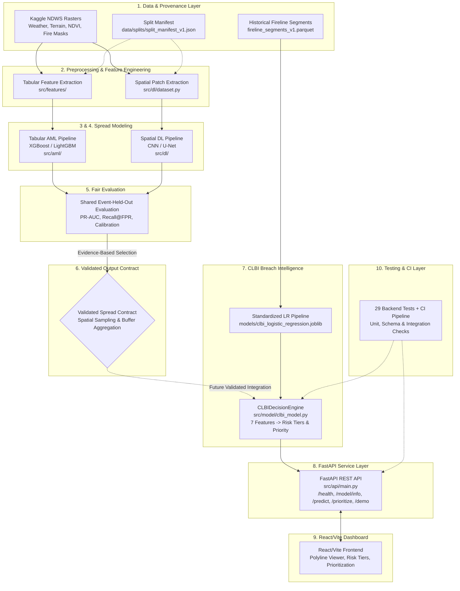

# Wildfire Intelligence — Architecture, Execution Plan & Contributor Roadmap

**Repository:** `vedant21-ctr/fireWild`  
**Default Branch:** `main`  
**Current Commit Baseline:** `37b3f4c`  
**Last Verified Audit Date:** 24 October 2026  
**Audience:** Project members, scientific collaborators, reviewers, open-source contributors.

> **CRITICAL SCIENTIFIC SCOPE SEPARATION:**  
> This repository contains two related but fundamentally distinct prediction tasks:
> 1. **Downstream Prototype (CLBI — Candidate Line Breach Intelligence):** Predicts holding versus breach probability for proposed 100-meter containment line segments based on terrain, barrier geometry, and fire interaction features.
> 2. **Upstream Academic Research (AML vs. Spatial DL Spread Prediction):** Uses the Kaggle Next Day Wildfire Spread (NDWS) raster dataset to model next-day wildfire perimeter progression.
> 
> **Never present CLBI breach probabilities as next-day wildfire spread forecasts, and never describe the `burn_prob` input of CLBI as an output of the planned AML or DL models until that integration has been implemented, validated, and verified.**

---

## 1. Project Vision & Research Objectives

The overall mission is to investigate:
1. Whether environmental, meteorological, topographic, and remotely sensed wildfire observations can provide actionable next-day fire spread predictions.
2. Whether predicted spread vectors and intensities can provide directional intelligence to evaluate candidate containment lines, stratifying risk to prioritize manual inspection resources.

### The Three Connected Modeling Pillars

```
+---------------------------------------------------------------------------------------+
|                                    fireWild SYSTEM                                    |
+---------------------------------------------------+-----------------------------------+
|            UPSTREAM SPREAD PREDICTION             |       DOWNSTREAM FIRELINE         |
|         (Kaggle NDWS Multi-Channel Data)          |     (Historical Benchmark)        |
+-------------------------+-------------------------+-----------------------------------+
|   PILLAR 1: AML PATH    |   PILLAR 2: SPATIAL DL  |        PILLAR 3: CLBI PATH        |
|  Tabular Tree Ensembles |      CNN / U-Net        |     Standardized LR Pipeline      |
|  (XGBoost / LightGBM)   |  (Multi-Channel Tensor) |    (7-Feature Decision Engine)    |
|   Tabular Spread Prob   |    Spatial Prob Map     |    Breach Probability & Tiers     |
+-------------------------+-------------------------+-----------------------------------+
|               SHARED EVENT-HELD-OUT EVALUATION    |   REST API & DASHBOARD INTERFACE  |
|               (PR-AUC, Recall@FPR, Calibration)   |   (FastAPI + React/Vite UI)       |
+---------------------------------------------------+-----------------------------------+
```

### Scientific Guardrails
- **Pre-Engagement Feature Provenance:** All features must represent state strictly prior to or at prediction time $t$. No post-outcome perimeter masks, mop-up data, or future observations may be included.
- **Event-Level & Temporal Separation:** Data splitting must strictly be grouped by wildfire complex and observation date. Random pixel-level or row-level splitting causes spatial autocorrelative leakage and is prohibited.
- **Metric Integrity for Imbalanced Regimes:** Accuracy alone is scientifically misleading in rare-burn regimes. Evaluation must prioritize Precision-Recall Area Under the Curve (PR-AUC), Recall at fixed False Positive Rates (e.g., Recall@10% FPR), F1 score, Brier score, and Expected Calibration Error (ECE).
- **Spatial Metadata Preservation:** Coordinate Reference Systems (CRS), affine transformation matrices, spatial resolutions, and channel orders must be tracked and validated.
- **Decision Support Classification:** All outputs are retrospective decision-support aids, not real-time tactical forecasts or guaranteed containment assurances.

---

## 2. Current Implementation Status

Audit performed against repository commit `37b3f4c` on branch `main` with 29 passing unit tests (`python -m unittest discover -s tests -p "test_*.py" -v`).

### Status Classification Matrix

| Component | Status | Details & Evidence |
| :--- | :--- | :--- |
| **CLBI Benchmark Dataset** | **Implemented & Verified** | `data/final/fireline_segments_v1.parquet` (4,600 segments across 5 California fires: August, Carr, Creek, Mendocino, CZU). Documented in `DATASET_CARD.md`. |
| **CLBI Model Artifacts** | **Implemented & Verified** | `models/clbi_logistic_regression.joblib` (StandardScaler + LogisticRegression) and `models/clbi_model_metadata.json`. Fitted on training split (`split == 'train'`). |
| **CLBI Inference Engine** | **Implemented & Verified** | `src/model/clbi_model.py` (`CLBIDecisionEngine`). Deterministic scoring, percentile ranking, risk tier assignment, and attribution. |
| **FastAPI Backend Service** | **Implemented & Verified** | `src/api/main.py`, `src/api/routes.py`, `src/api/schemas.py`. 6 endpoints active with CORS for ports 5173, 3000, 8000. Verified by 15 API unit tests. |
| **CLBI Unit Test Suite** | **Implemented & Verified** | 29/29 tests passing (14 model tests in `tests/test_clbi_model.py`, 15 API tests in `tests/test_api.py`). |
| **CLBI Experiment Reports** | **Experimental / Retrospective** | 5 research reports in `experiments/`: `BASELINE_REPORT.md`, `ROBUSTNESS_REPORT.md`, `NONLINEAR_BASELINE_REPORT.md`, `SPATIAL_ABLATION_REPORT.md`, `RISK_STRATIFICATION_REPORT.md`. |
| **React/Vite Dashboard** | **Planned (Not Implemented)** | No frontend directory, `package.json`, or UI build exists in repository. Planned in Phase 1. |
| **NDWS Data Audit & Splits** | **Planned (Not Implemented)** | Raw NDWS data not yet inventoried or committed; split manifest not finalized. Phase 0 priority. |
| **Tabular AML Pipeline** | **Planned (Not Implemented)** | XGBoost/LightGBM feature extraction and models for next-day spread not yet implemented. Phase 2. |
| **Spatial DL Pipeline** | **Planned (Not Implemented)** | Multi-channel raster patch generation, CNN/U-Net baselines not yet implemented. Phase 3. |
| **AML vs. DL Evaluation** | **Planned (Not Implemented)** | Comparative evaluation on shared held-out events not yet conducted. Phase 4. |
| **Spread-to-CLBI Integration**| **Blocked on Prerequisites** | Connecting dynamic `burn_prob` from AML/DL into CLBI is blocked until Phase 2 and Phase 3 produce validated, calibrated outputs. |

### Verified CLBI REST API Routes (`src/api/routes.py`)

All routes are fully implemented, typed via Pydantic (`src/api/schemas.py`), and covered by unit tests:

1. **`GET /api/v1/health`**  
   - Purpose: Service health and version check.  
   - Returns: `{"status": "ok", "service": "CLBI API", "version": "1.0.0"}`
2. **`GET /api/v1/model/info`**  
   - Purpose: Model provenance, 7 input features, operational risk thresholds, and evaluation provenance.  
   - Returns: Model type, feature list, risk thresholds (`LOW`: <0.30, `MEDIUM`: 0.30–0.60, `HIGH`: 0.60–0.80, `CRITICAL`: $\ge 0.80$), training row count (3,050), and 5-fold LOFO metrics.
3. **`GET /api/v1/demo`**  
   - Purpose: Deterministic 100-segment demo payload for CZU Lightning Complex fire.  
   - Returns: Metadata, risk tier breakdown, top-10% cutoff counts, and 100 scored segments with vulnerability ranks and attributions.
4. **`POST /api/v1/predict`**  
   - Purpose: Single-segment breach risk inference.  
   - Population fields (`vulnerability_rank`, `priority_percentile`, `priority_recommended`) return `null` because single segments lack population context.
5. **`POST /api/v1/predict/batch`**  
   - Purpose: Batch inference for candidate lines.  
   - Computes deterministic breach probability, assigns risk tiers, and evaluates population-relative vulnerability rankings and percentiles.
6. **`POST /api/v1/prioritize`**  
   - Purpose: Candidate containment line prioritization.  
   - Filters segments by percentage (e.g., top 10%) or integer count, returning segments sorted descending by breach probability.

### The 7 Validated Pre-Engagement CLBI Inputs
1. `slope`: Terrain slope gradient in degrees ($\ge 0$).
2. `elevation`: Surface elevation in meters above sea level.
3. `distance_to_fire`: Euclidean distance to active flame front at day $t$ in meters ($\ge 0$).
4. `barrier_width_m`: Physical cleared fuel barrier width in meters ($> 0$).
5. `burn_prob`: Predicted next-day burn probability intensity in $[0.0, 1.0]$. *(In current retrospective benchmark, computed from baseline formulation; NOT yet fed from live AML/DL models).*
6. `attack_angle`: Acute interaction angle between line normal and prevailing fire spread vector in degrees $[0^\circ, 90^\circ]$.
7. `attack_dot_product`: Direct head-fire attack alignment ratio ($\cos\theta_{\text{attack}}$) in $[-1.0, 1.0]$.

### Documented Empirical Results & Explicit Limitations
- **Mean LOFO PR-AUC:** $0.9508 \pm 0.0076$ across 5 held-out wildfire complexes (August Complex, Carr Fire, Creek Fire, Mendocino Complex, CZU Lightning Complex).
- **Calibration:** Global Brier score = $0.1199$; 10-bin sample-weighted ECE = $0.0109$.
- **Inspection Yield:** Top-10% highest-risk segments yield $89.6\%$ precision; top-20% captures $53.8\%$ of breaches ($2.92\times$ enrichment over random inspection).
- **Spatial Neighborhood Ablation Result:** Adding 1D polyline neighbor features yielded $\Delta \text{PR-AUC} = -0.0003$ across all 5 fires, halting GNN development due to lack of empirical gain (`SPATIAL_ABLATION_REPORT.md`).
- **Non-Linear Tree Baseline Result:** `HistGradientBoosting` ($0.9399$) and `RandomForest` ($0.9343$) underperformed linear Logistic Regression ($0.9508$), showing single-segment tabular modeling has reached its empirical ceiling (`NONLINEAR_BASELINE_REPORT.md`).
- **Limitations:**
  - Evaluated on 5 historical Northern California incidents; generalization across different fuel models and regions requires further testing.
  - Daily temporal resolution; cannot support sub-hourly tactical fire behaviour.
  - Feature coefficients denote statistical associations, not causal physical mechanisms.

---

## 3. Finalized Project Execution Plan

The execution plan follows a strict dependency order. Workstreams must not skip phases without meeting the predeclared exit criteria.

```
Phase 0: Foundation, Data Audit & Reproducibility
   |
   v
Phase 1: CLBI Backend Maintenance & React/Vite Dashboard
   |
   v
Phase 2: Tabular AML Spread Prediction Pipeline (NDWS)
   |
   v
Phase 3: Spatial Deep Learning Pipeline (NDWS Rasters)
   |
   v
Phase 4: Fair AML vs. DL Benchmark Evaluation
   |
   v
Phase 5: Validated Spread Output Integration into CLBI
   |
   v
Phase 6: Packaging, CI/CD, Release & Handover
```

---

### Phase 0 — Foundation, Data Audit, and Reproducibility
**Objective:** Establish complete provenance for existing CLBI datasets and audit the raw Kaggle Next Day Wildfire Spread (NDWS) dataset before modeling.

#### Detailed Tasks:
1. **NDWS Dataset Inventory:**
   - Catalog raw NDWS data files, source URL, data license, geographical coverage (states, years), and storage size.
   - Audit raster channel definitions: elevation, wind speed, wind direction, temperature, humidity, precipitation, drought index, vegetation (NDVI), and historical burn masks.
   - Record spatial resolutions, Coordinate Reference Systems (CRS), bounding boxes, and nodata conventions.
2. **CLBI Benchmark Data Provenance Audit:**
   - Trace the exact derivation of `fireline_segments_v1.parquet` from raw incident layers in `src/data/build_dataset.py`.
   - Explicitly classify every column as: `observed`, `derived`, `retrospective`, `synthetic`, or `simulated`.
   - Verify whether raw incident files are sufficient to rebuild `fireline_segments_v1` from scratch.
3. **Leakage & Target Horizon Definition:**
   - Formally specify the next-day spread target: what constitutes a "burn" at day $t+1$ (e.g., MODIS/VIIRS active fire pixel detection within a 24-hour window).
   - Ensure input features represent observations strictly available at or before observation cutoff $t$.
4. **Reproducible Split Strategy & Split Manifest:**
   - Design an event-level split strategy: wildfire complexes in the test set must never appear in training or validation splits.
   - Create an immutable split manifest file (`data/splits/split_manifest_v1.json`) recording fire IDs, dates, and split assignments.
5. **Baseline Evaluation Checklist:**
   - Establish shared evaluation script templates for PR-AUC, ROC-AUC, Brier score, ECE, and confusion matrices.

**Exit Criteria:**
- Written Data Inventory & Provenance Report published in `docs/DATA_INVENTORY_AND_PROVENANCE.md`.
- Immutable split manifest committed in `data/splits/split_manifest_v1.json`.
- Clean-clone reproduction of CLBI model training from source data verified.
- Open data questions, risks, and license constraints documented.

---

### Phase 1 — Existing CLBI Backend & Frontend Foundation
**Objective:** Deliver an operational command-and-control dashboard for the completed CLBI backend while preserving existing model behavior and API contracts.

#### Detailed Tasks:
1. **Backend Verification & Maintenance:**
   - Preserve existing FastAPI routes (`/health`, `/model/info`, `/demo`, `/predict`, `/predict/batch`, `/prioritize`) and Pydantic schemas.
   - Confirm all 29 unit tests continue passing without regression.
2. **React/Vite Dashboard Scaffolding:**
   - Initialize Vite React project in `frontend/` using Vanilla CSS.
   - Implement dark charcoal/navy command aesthetic (`#0f172a` background, `#1e293b` cards) with fire-amber and safety accents.
   - Define calibrated risk badges: `LOW` (`#22c55e`), `MEDIUM` (`#eab308`), `HIGH` (`#f97316`), `CRITICAL` (`#ef4444`).
   - Configure development proxy in `frontend/vite.config.js` to target `http://127.0.0.1:8000`.
3. **Core Dashboard Views:**
   - **System Header:** Live backend health status indicator (`GET /api/v1/health`), model provenance badge (`GET /api/v1/model/info`), and persistent scientific disclaimer:  
     `"RETROSPECTIVE DECISION SUPPORT — NOT A LIVE FIRE FORECAST."`
   - **Executive Metric Strip:** Total segments, mean breach probability, and segment counts across the 4 risk tiers.
   - **Candidate Line Polyline Visualizer:** Interactive 1D segment ribbon (segments 1 to 100) color-coded by risk tier, with indicators for the top-10% recommended inspection set.
   - **Prioritization Panel:** Resource allocation slider / toggle (Top 10%, Top 20%, or custom count) calling `POST /api/v1/prioritize` to filter high-risk segments.
   - **Segment Inspector Drawer:** Detailed card showing exact breach probability, 7 input feature values, top risk factors, protective factors, and explanation.
   - **"What-If" Simulation Sandbox:** Interactive sliders for the 7 inputs calling `POST /api/v1/predict` live.
   - **Planned Section Placeholders:** "AML Tabular Spread Prediction" and "Spatial DL Prediction" views clearly labeled as *In Development / Planned for Phase 2 & 3*.
4. **Frontend Testing & Verification:**
   - Verify build succeeds via `npm run build` without TypeScript/lint errors.
   - Test empty, loading, error, and healthy API states.

**Exit Criteria:**
- Fully functioning React/Vite dashboard in `frontend/` connected to live FastAPI backend.
- CLBI demo, single prediction, and prioritization functional in UI.
- AML and DL views prominently marked as planned without synthetic or fabricated data.
- Setup and startup instructions documented and verified.

---

### Phase 2 — Tabular AML Next-Day Spread Prediction
**Objective:** Build a reproducible feature engineering and tabular model pipeline predicting next-day wildfire spread from NDWS tabularized rasters.

#### Detailed Tasks:
1. **NDWS Tabular Extraction:**
   - Convert multi-channel spatial rasters at day $t$ into structured tabular records for fire/non-fire grid cells.
   - Define binary target: `fire_next_day` $\in \{0, 1\}$ at day $t+1$.
2. **Feature Engineering Pipeline (`src/features/`):**
   - Weather: Temperature, relative humidity, wind speed, wind direction, precipitation.
   - Topography: Slope, elevation, aspect.
   - Vegetation & Drought: Fuel indices, NDVI, drought severity indicators.
   - Fire Context: Active fire distance, lagged fire history ($t-1, t-2$), neighborhood active fire counts.
   - Enforce temporal safety: ensure all features are strictly available at observation time $t$.
3. **Reproducible Modeling:**
   - Baseline: Logistic regression and dummy majority-class predictor.
   - Primary Models: Train and tune XGBoost and LightGBM models.
   - Evaluation Protocol: Strictly evaluate using the event-level split manifest from Phase 0.
   - Record metrics: PR-AUC, ROC-AUC, F1, Recall@5% FPR, Recall@10% FPR, Brier score.
4. **Model Artifact Serialization:**
   - Save trained model pipelines, configuration JSONs, feature importance plots, and PR curves in `models/aml/` and `experiments/results/`.

**Exit Criteria:**
- Reproducible training and evaluation scripts in `src/aml/`.
- Documented baseline and boosted tree results in `experiments/AML_SPREAD_REPORT.md`.
- Formally defined spread prediction output schema specifying probability meanings and coordinates.

---

### Phase 3 — Spatial Deep Learning
**Objective:** Construct a spatial patch extraction pipeline and train deep learning models (CNN / U-Net) directly on aligned multichannel raster tensors.

#### Detailed Tasks:
1. **Spatial Tensor Pipeline (`src/dl/`):**
   - Extract fixed-size spatial patches (e.g., $64 \times 64$ or $128 \times 128$ grid cells) centered on fire boundaries.
   - Align multi-channel layers: elevation, slope, wind components ($u, v$), temperature, humidity, vegetation, and current fire mask.
   - Ensure spatial coordinate transformations, resolutions, and boundary checks are strictly preserved.
   - Ensure patches from test events never enter training batches.
2. **Model Architectures:**
   - Baseline: Lightweight 2D Convolutional Neural Network (CNN).
   - Advanced: 2D U-Net for dense spatial probability map generation.
   - Sequence Check: Evaluate ConvLSTM *only* if consecutive multi-day sequences have valid temporal alignment without gaps.
3. **Training & Loss Optimization:**
   - Handle extreme spatial class imbalance via Weighted Binary Cross-Entropy, Focal Loss, or Dice Loss.
   - Compute metrics across held-out event patches: spatial PR-AUC, Dice/IoU coefficient, and pixel-level calibration.
4. **Artifacts & Maps:**
   - Serialize model weights to `models/dl/`.
   - Export georeferenced prediction GeoTIFFs/rasters for visual QA inspection.

**Exit Criteria:**
- Working spatial data loader and training pipeline in `src/dl/`.
- Trained spatial baseline model with evaluated PR-AUC and calibration.
- Published `experiments/SPATIAL_DL_REPORT.md` including visual spatial error maps.

---

### Phase 4 — Fair AML vs. DL Evaluation
**Objective:** Execute a rigorous, head-to-head scientific comparison between tabular AML and spatial DL on identical held-out fire events.

#### Detailed Tasks:
1. **Unified Evaluation Protocol:**
   - Both models must be evaluated on the exact same held-out wildfire complexes and temporal horizons specified in Phase 0.
   - Targets must be semantically equivalent (predicting identical pixel/cell fire presence at $t+1$).
2. **Comparative Benchmark Metrics:**
   - Tabulate PR-AUC, ROC-AUC, F1 score, Recall at fixed FPR (1%, 5%, 10%), Brier score, and ECE.
   - Stratify results by individual wildfire complex to assess cross-incident generalization variance.
3. **Operational Trade-Off Analysis:**
   - Compare compute requirements: training time, memory footprint, inference latency per square kilometer.
   - Compare operational interpretability: tree feature importances vs. CNN saliency / attention maps.
4. **Synthesis Report:**
   - Publish `experiments/AML_VS_DL_COMPARISON_REPORT.md` providing objective findings, limitations, and an evidence-based recommendation for downstream use.

**Exit Criteria:**
- Completed comparison report distinguishing measured performance from hypotheses.
- Clear, evidence-based determination of which model (or ensemble) produces the most reliable spread probabilities.

---

### Phase 5 — Integrate Validated Spread Prediction into CLBI
**Objective:** Connect the validated upstream spread prediction output into the downstream CLBI containment line decision engine.

#### Detailed Tasks:
1. **Spread-to-Line Interface Contract:**
   - Formulate a formal interface contract mapping continuous spatial spread probability maps onto 100-meter candidate fireline segments.
   - Define spatial sampling rules: maximum, mean, or quantile spread probability within a buffer zone (e.g., 200m) of the segment.
2. **Semantics & Validation of `burn_prob`:**
   - Validate that the mapped value preserves the physical meaning of `burn_prob` expected by `CLBIDecisionEngine`.
   - Define fallback behavior if spread prediction is missing, uncalibrated, or out-of-bounds (e.g., fallback to static baseline model).
3. **Integration Testing:**
   - Write automated unit and integration tests verifying end-to-end data flow from raster prediction to line breach score.
   - Confirm existing API schemas and contracts remain backward-compatible.
4. **Downstream Holding Impact Evaluation:**
   - Re-evaluate CLBI breach prediction accuracy using the newly integrated dynamic `burn_prob` against the historical baseline.

**Exit Criteria:**
- Fully tested and documented integration module in `src/model/integration.py`.
- Automated integration tests passing.
- Published `experiments/INTEGRATED_CLBI_EVALUATION_REPORT.md`.

---

### Phase 6 — Release, CI, Documentation, and Handover
**Objective:** Finalize automated continuous integration, packaging, deployment configurations, and contributor onboarding documentation.

#### Detailed Tasks:
1. **Continuous Integration (CI):**
   - Set up GitHub Actions workflow (`.github/workflows/ci.yml`) running backend Python tests, linting (`flake8`/`black`), and frontend build tests (`npm run build`).
2. **Containerization & Deployment:**
   - Create multi-stage `Dockerfile` and `docker-compose.yml` for unified local execution of backend and frontend.
3. **Repository Documentation & Handover:**
   - Finalize root `README.md` reflecting complete system architecture.
   - Verify that all data sources, model weights, and reproduction commands are clearly documented.
   - Conduct clean-clone verification on a separate environment.

**Exit Criteria:**
- All CI checks passing on GitHub.
- Working Docker Compose configuration.
- Comprehensive documentation and contributor guide.

---

## 4. Target System Architecture



### Detailed 10-Layer Architecture Breakdown

1. **Data and Provenance Layer:**  
   Houses raw NDWS datasets, historical fireline benchmark files (`data/final/fireline_segments_v1.parquet`), and the immutable event-level split manifest. Raw, unredacted, or large rasters remain in `.gitignore`.
2. **Preprocessing and Feature Engineering Layer:**  
   Houses tabular vector extractors (`src/features/`) and spatial tensor generators (`src/dl/`). Ensures zero outcome leakage and pre-engagement temporal alignment.
3. **Tabular AML Training and Inference Layer:**  
   Trains, tunes, and evaluates XGBoost and LightGBM models on structured environmental features for point-wise next-day spread probability.
4. **Spatial DL Preprocessing, Training, and Inference Layer:**  
   Trains and evaluates 2D CNNs / U-Nets on multi-channel raster patches to output 2D spatial probability fields.
5. **Evaluation and Model Comparison Layer:**  
   Executes fair, identical-split benchmarks comparing AML and DL on PR-AUC, Brier score, ECE, and operational metrics.
6. **Validated Spread-Prediction Output Contract:**  
   Defines the strict schema and spatial buffering required to sample continuous spread probabilities onto candidate fireline segments.
7. **CLBI Breach-Risk Inference Layer:**  
   The core `CLBIDecisionEngine` evaluating the 7 inputs via the serialized pipeline (`models/clbi_logistic_regression.joblib`), outputting calibrated probabilities, risk tiers, percentile rankings, and structured explanations.
8. **FastAPI Service Layer:**  
   Exposes endpoints with Pydantic validation, structured error handling, and CORS middleware for local frontend consumption.
9. **React/Vite Dashboard Layer:**  
   Provides interactive decision support: candidate polyline ribbons, risk tier aggregations, top-10% inspection filters, and "what-if" parameter sliders.
10. **Testing, Experiment Tracking, and CI Layer:**  
    Enforces unit tests, schema contracts, deterministic regression testing, and automated GitHub Actions verification.

### Proposed Target Repository Structure

*(Note: Proposal only. Existing files and active scripts must not be moved or deleted merely to conform to this layout).*

```text
fireWild/
├── .github/
│   └── workflows/
│       └── ci.yml                     # Automated CI pipeline
├── data/
│   ├── demo/
│   │   └── clbi_demo_segments.csv     # 100 deterministic demo segments
│   ├── final/
│   │   ├── fireline_segments_v1.parquet
│   │   ├── fireline_segments_v1.csv
│   │   └── fireline_segments_v1.json
│   ├── raw/                           # Gitignored raw NDWS & incident files
│   └── splits/
│       └── split_manifest_v1.json     # Event-level split manifest
├── docs/
│   ├── CLBI_API_CONTRACT.md           # REST API specification
│   ├── CLBI_METRICS.md                # Metric definitions & benchmark formulas
│   ├── DATASET_CARD.md                # Dataset documentation & provenance
│   └── PROJECT_ARCHITECTURE_AND_ROADMAP.md # THIS DOCUMENT
├── experiments/
│   ├── BASELINE_REPORT.md
│   ├── ROBUSTNESS_REPORT.md
│   ├── NONLINEAR_BASELINE_REPORT.md
│   ├── SPATIAL_ABLATION_REPORT.md
│   ├── RISK_STRATIFICATION_REPORT.md
│   └── results/                       # Serialized metrics, plots, and CSVs
├── frontend/                          # React/Vite dashboard application
│   ├── src/
│   │   ├── components/
│   │   ├── App.jsx
│   │   └── index.css
│   ├── package.json
│   └── vite.config.js
├── models/
│   ├── clbi_logistic_regression.joblib# Serialized production CLBI model
│   └── clbi_model_metadata.json       # Production model metadata
├── src/
│   ├── aml/                           # Tabular AML spread models (Phase 2)
│   ├── api/                           # FastAPI service layer (Phase 1)
│   │   ├── main.py
│   │   ├── routes.py
│   │   └── schemas.py
│   ├── data/                          # Dataset builder pipelines
│   │   └── build_dataset.py
│   ├── dl/                            # Spatial DL models & loaders (Phase 3)
│   ├── evaluation/                    # Reproducible benchmark experiments
│   ├── features/                      # Feature extraction & quality checks
│   └── model/                         # Core CLBI decision engine & demo
│       ├── clbi_model.py
│       ├── clbi_demo.py
│       └── train_clbi_model.py
├── tests/
│   ├── test_api.py                    # 15 FastAPI endpoint tests
│   └── test_clbi_model.py             # 14 CLBIDecisionEngine unit tests
├── requirements.txt                   # Backend dependencies
└── README.md                          # Project overview & quickstart
```

---

## 5. Contributor Workstreams

To enable parallel execution across multiple collaborators, responsibilities are grouped into 7 modular workstreams. Each workstream defines concrete prerequisites, deliverables, and acceptance criteria.

```
+-----------------------------------------------------------------------------------------+
|                               CONTRIBUTOR WORKSTREAM MAP                                |
+-----------------------------------------------------------------------------------------+
|  WORKSTREAM 1: Coordination & Reproducibility     | Immediate Start (Phase 0)           |
|  WORKSTREAM 2: Data Engineering & GIS Provenance  | Immediate Start (Phase 0)           |
|  WORKSTREAM 3: Frontend Dashboard & UX            | Immediate Start (Phase 1)           |
|  WORKSTREAM 4: Backend Maintenance & Integration  | Active (Preserve & Extend Phase 1/5)|
|  WORKSTREAM 5: AML Tabular Modeling Pipeline      | Blocked on WS 1 & 2 (Phase 2)       |
|  WORKSTREAM 6: Spatial DL Modeling Pipeline       | Blocked on WS 1 & 2 (Phase 3)       |
|  WORKSTREAM 7: CI/CD, Testing & Release Handover  | Active throughout (Phase 6)         |
+-----------------------------------------------------------------------------------------+
```

### Detailed Workstream Specifications

#### Workstream 1: Project Coordination, Issues & Reproducibility
- **Status:** **Ready to start immediately.**
- **Prerequisites:** Access to repository and project issue tracker.
- **Responsibilities:**
  - Create and manage GitHub issues with explicit acceptance criteria.
  - Coordinate review checkpoints between data, modeling, and API workstreams.
  - Maintain the project decision log and keep roadmap checkboxes synchronized with audited progress.
- **Deliverables:** GitHub issue milestones, project board, updated roadmap records.
- **Acceptance Criteria:** Every pull request links to an open issue with clear acceptance criteria and no untracked dependencies.

#### Workstream 2: Data Engineering, GIS & Data Provenance
- **Status:** **Ready to start immediately (Phase 0 Priority).**
- **Prerequisites:** Access to Kaggle NDWS dataset download and raw fire incident sources.
- **Responsibilities:**
  - Audit and inventory NDWS raster channels, resolutions, CRS, and temporal bounds.
  - Verify data cleanliness, missing-value policies, and zero outcome leakage.
  - Produce the immutable event-level split manifest (`data/splits/split_manifest_v1.json`).
  - Audit existing CLBI features to document observed vs. simulated data columns.
- **Deliverables:** `docs/DATA_INVENTORY_AND_PROVENANCE.md`, `data/splits/split_manifest_v1.json`.
- **Acceptance Criteria:** Clean-clone verification script validates raster alignment and splits without runtime errors.

#### Workstream 3: Frontend & Dashboard UX
- **Status:** **Ready to start immediately (Phase 1 Priority).**
- **Prerequisites:** Running FastAPI backend (`http://127.0.0.1:8000`).
- **Responsibilities:**
  - Scaffold Vite React app in `frontend/` using Vanilla CSS design tokens.
  - Build command-center interface: Header with backend health check, metric cards, 1D polyline segment visualizer, risk tier badges, prioritization controls, and segment attribution drawer.
  - Implement "What-If" simulation sandbox with parameter sliders for the 7 CLBI inputs.
  - Ensure AML and DL screens display informative placeholder banners stating features are in development.
- **Deliverables:** Working React app in `frontend/`, production build script, screenshots.
- **Acceptance Criteria:** `npm run build` succeeds; all 6 backend endpoints are interactive in the UI with loading, error, and data states.

#### Workstream 4: CLBI Backend & Prediction-Contract Integration
- **Status:** **Active (Phase 1 Maintenance & Phase 5 Integration).**
- **Prerequisites:** Existing Python test suite passing (29 tests).
- **Responsibilities:**
  - Maintain existing FastAPI routes, schemas, and model determinism.
  - Define the prediction-contract schema for consuming upstream spread outputs (`burn_prob`).
  - Implement spatial buffering to map grid spread probabilities to 100-meter line segments.
  - Add fallback logic for missing or out-of-range spread inputs.
- **Deliverables:** Updated API routes, integration modules, unit tests for schema validation.
- **Acceptance Criteria:** Zero regression on existing 29 unit tests; backward-compatible API contracts.

#### Workstream 5: AML Pipeline & Tabular Model Evaluation
- **Status:** **Blocked on Workstreams 1 & 2 (Phase 2).**
- **Prerequisites:** Completion of Phase 0 data audit and immutable split manifest.
- **Responsibilities:**
  - Implement tabular feature extraction from NDWS rasters (weather, terrain, vegetation, lagged fire).
  - Train baseline logistic regression and primary XGBoost/LightGBM models.
  - Perform hyperparameter tuning on validation split only.
  - Evaluate PR-AUC, Recall@FPR, F1, and calibration across held-out events.
- **Deliverables:** `src/aml/` training scripts, serialized models in `models/aml/`, `experiments/AML_SPREAD_REPORT.md`.
- **Acceptance Criteria:** Pipeline runs deterministically from command line; PR-AUC exceeds baseline with full leakage audit.

#### Workstream 6: Spatial DL Pipeline & Raster Validation
- **Status:** **Blocked on Workstreams 1 & 2 (Phase 3).**
- **Prerequisites:** Completion of Phase 0 raster alignment and split manifest.
- **Responsibilities:**
  - Build spatial patch data loader preserving CRS, transforms, and channel alignment.
  - Train 2D CNN baseline and U-Net architecture with class-weighted/focal loss.
  - Output georeferenced prediction GeoTIFFs for spatial error analysis.
- **Deliverables:** `src/dl/` data loaders and models, serialized weights in `models/dl/`, `experiments/SPATIAL_DL_REPORT.md`.
- **Acceptance Criteria:** Reproducible patch extraction; training achieves convergence without spatial leakage across splits.

#### Workstream 7: Testing, Documentation & CI/CD
- **Status:** **Active throughout all phases.**
- **Prerequisites:** Git repository write access.
- **Responsibilities:**
  - Maintain GitHub Actions CI workflow covering Python tests, linting, and frontend builds.
  - Ensure all benchmark reports are accompanied by exact reproduction commands and seeds.
  - Validate that no secrets, credentials, or large raw datasets are committed to Git.
- **Deliverables:** `.github/workflows/ci.yml`, Dockerfile, clean-clone onboarding guide.
- **Acceptance Criteria:** CI runs green on all pull requests; clean-clone setup executes in $<10$ minutes.

---

## 6. GitHub Collaboration Workflow & Contribution Rules

To ensure scientific reproducibility, code quality, and branch stability, all contributors must adhere to this standardized workflow.

```
+-----------------------------------------------------------------------------------------+
|                               GITHUB COLLABORATION LIFECYCLE                            |
+-----------------------------------------------------------------------------------------+
| 1. Issue Creation (Context, Scope, Acceptance Criteria)                                 |
|    |                                                                                    |
| 2. Branch from main (e.g., feat/clbi-dashboard, docs/data-audit)                        |
|    |                                                                                    |
| 3. Local Implementation & Test Verification                                             |
|    |                                                                                    |
| 4. Pull Request Opened (Linked to Issue, Reproduction Commands, Diffs)                  |
|    |                                                                                    |
| 5. Review & CI Verification (Data Leakage, API Compatibility, 29 Tests)                 |
|    |                                                                                    |
| 6. Squash / Rebase Merge into main                                                      |
+-----------------------------------------------------------------------------------------+
```

### The 9-Step Development Lifecycle
1. **Create a Focused GitHub Issue:** Define the problem statement, user story, dependencies, and explicit acceptance criteria.
2. **Assign Ownership & Reviewers:** Designate one accountable author and at least one technical reviewer (specifically reviewing for data leakage on ML PRs or API compatibility on backend PRs).
3. **Create a Semantic Branch:** Branch from latest `main`:
   - `feat/clbi-dashboard-scaffold`
   - `docs/ndws-provenance-audit`
   - `feat/aml-feature-pipeline`
   - `feat/dl-unet-baseline`
   - `fix/api-schema-validation`
4. **Implement in Small, Focused Batches:** Avoid multi-thousand-line monolithic changes. Keep commits logically separated.
5. **Run Local Verification Checks:** Execute relevant test suites and record exact output:
   ```bash
   python -m unittest discover -s tests -p "test_*.py" -v
   ```
6. **Update Documentation & Provenance:** Any modification to schemas, feature definitions, or model weights must be reflected in documentation.
7. **Open Pull Request Linked to Issue:** Include a clear description of changes, test commands, before/after metric tables or UI screenshots, and explicit limitations.
8. **Conduct Thorough Peer Review:** Reviewers must verify:
   - Zero target or temporal leakage.
   - No hardcoded absolute local paths.
   - No modified model thresholds without justification.
   - Backward compatibility of the 6 existing REST API routes.
9. **Merge after Green CI:** Merge using squash-and-merge or rebase to maintain a linear, clean commit history.

### Strict Contribution Rules
- **Zero Credentials / Large Data in Git:** Never commit API tokens, passwords, local absolute paths, or raw raster datasets exceeding GitHub file size guidelines.
- **Truth in Benchmarking:** Never claim an experiment or test passed unless it was genuinely executed and the log/artifact is available.
- **Preserve Validated Artifacts:** Do not overwrite `models/clbi_logistic_regression.joblib` or alter existing report markdown files in `experiments/` without reviewed experimental justification.
- **Pre-Registration of Split Manifests:** Model hyperparameters and architectures must not be selected based on test-set performance.

---

## 7. Prioritized Next-Actions Checklist

The immediate path forward is prioritized by concrete dependency requirements. Blockers are explicitly declared.

| Step | Priority | Action Item | Assigned Workstream | Status / Blocker |
| :---: | :---: | :--- | :---: | :--- |
| **1** | **Immediate** | Verify architecture document alignment against current local repository. | Coordination | **IN PROGRESS** |
| **2** | **Immediate** | Execute Phase 0 Data & Provenance Audit for NDWS rasters and CLBI source files. | Data / GIS | **READY TO START** |
| **3** | **Immediate** | Create GitHub issues for Phase 0 (Data Audit) and Phase 1 (Frontend Dashboard). | Coordination | **READY TO START** |
| **4** | **Immediate** | Scaffold React/Vite dashboard in `frontend/` connecting to live CLBI API. | Frontend / UX | **READY TO START** |
| **5** | **Immediate** | Establish and commit immutable split manifest (`data/splits/split_manifest_v1.json`). | Data / GIS | **READY TO START** |
| **6** | **Phase 2** | Build reproducible AML tabular extraction and train baseline XGBoost/LightGBM. | AML | 🔴 *Blocked on Step 2 & 5* |
| **7** | **Phase 3** | Construct spatial patch pipeline and train 2D CNN / U-Net baseline on NDWS rasters. | Spatial DL | 🔴 *Blocked on Step 2 & 5* |
| **8** | **Phase 4** | Execute fair head-to-head comparison between AML and DL on held-out events. | Validation | 🔴 *Blocked on Step 6 & 7* |
| **9** | **Phase 5** | Formulate prediction contract and integrate validated spread output into CLBI. | Backend / CLBI | 🔴 *Blocked on Step 8* |
| **10**| **Phase 6** | Implement GitHub Actions CI, containerization, and final handover package. | DevOps / CI | Active throughout |

---

## 8. Local Setup & Verification Guide

### 1. Environment Setup

```bash
# Clone repository
git clone https://github.com/vedant21-ctr/fireWild.git
cd fireWild

# Create and activate virtual environment
python -m venv .venv
# On Windows PowerShell:
.venv\Scripts\Activate.ps1
# On Linux/macOS:
source .venv/bin/activate

# Install backend dependencies
python -m pip install -r requirements.txt
```

### 2. Verify Backend Test Suite (29 Tests)

```bash
python -m unittest discover -s tests -p "test_*.py" -v
```

Expected output:
```text
Ran 29 tests in ~2.2s
OK
```

### 3. Launch FastAPI Development Server

```bash
python -m uvicorn src.api.main:app --host 127.0.0.1 --port 8000 --reload
```

- API Base URL: `http://127.0.0.1:8000`
- Interactive OpenAPI Docs: `http://127.0.0.1:8000/docs`
- Health Check: `http://127.0.0.1:8000/api/v1/health`
- Model Provenance: `http://127.0.0.1:8000/api/v1/model/info`
- 100-Segment Benchmark Demo: `http://127.0.0.1:8000/api/v1/demo`

### 4. Planned Frontend Launch (Post-Phase 1 Scaffolding)

```bash
cd frontend
npm install
npm run dev
```

Dashboard will be accessible at `http://localhost:5173`.
