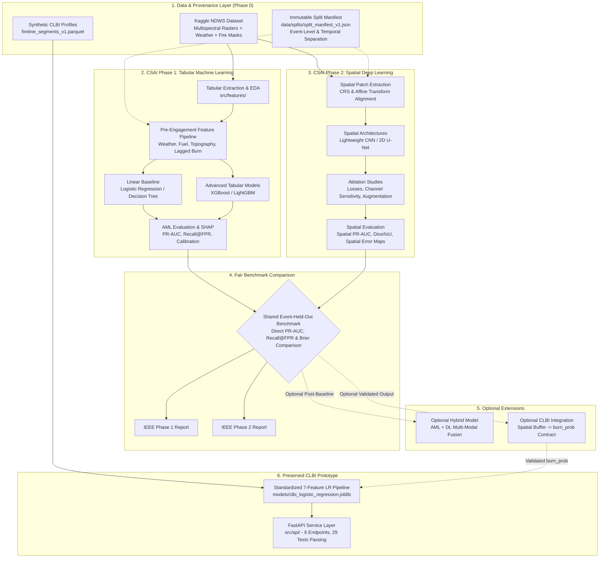

# Wildfire Intelligence — Architecture, CSAI Evaluation Alignment & Execution Roadmap

**Repository:** `vedant21-ctr/fireWild`  
**Default Branch:** `main`  
**Current Commit Baseline:** `f00ccf9`  
**Academic Framework:** CSAI Student Project Evaluation Guidelines (Phase 1: Machine Learning & Phase 2: Deep Learning)  
**Last Updated:** 24 October 2026  
**Audience:** Course evaluators, project team members (5-student cohort), technical reviewers, open-source collaborators.

> **CRITICAL SCIENTIFIC & EVALUATION SCOPE DISTINCTION:**  
> This project encompasses two connected but strictly decoupled prediction problems:
> 1. **Core CSAI Academic Research:** Next-day wildfire spread and burning prediction using the Kaggle Next Day Wildfire Spread (NDWS) dataset. This is the primary academic focus evaluated under **Phase 1 (Machine Learning)** and **Phase 2 (Deep Learning)**.
> 2. **Downstream Prototype (CLBI):** Candidate Line Breach Intelligence demonstrates candidate-line scoring on a synthetic dataset. Its named fire profiles are not measured incident data, and its segment features and outcomes are generated rather than observed.
> 
> **Evaluation Rules:**
> - The existing CLBI model is an offline synthetic-data prototype; it is **NOT** a substitute for the required CSAI Phase 1 ML or Phase 2 DL spread-prediction models and is not validated for real-fire use.
> - The CLBI input feature `burn_prob` must **NOT** be described or treated as an output from the planned AML or DL models until that integration has been implemented, empirically validated, and tested.
> - Under no circumstances should spatial Deep Learning be implemented as a workaround for incomplete Phase 1 Machine Learning requirements.

---

## 1. Project Vision & Research Objectives

Wildfire containment and suppression planning requires accurate predictive intelligence at two complementary spatial and operational scales:
1. **Landscape-Scale Spread Modeling (Core CSAI Problem):** Predict where an active wildfire front will expand over the next 24 hours ($t+1$) given satellite remote sensing observations, topography, vegetation health, drought indicators, and weather conditions at day $t$.
2. **Tactical Barrier Integrity Modeling (CLBI Downstream Extension):** Given a proposed containment fireline, predict which 100-meter line segments face heightened risk of breach by head-fire flame impingement, enabling fire managers to allocate scarce scraping and inspection crews efficiently.

### System Concept

```
+---------------------------------------------------------------------------------------------------+
|                                  fireWild RESEARCH ARCHITECTURE                                   |
+-----------------------------------------------------------------+---------------------------------+
|               CORE CSAI RESEARCH (NDWS DATASET)                 |      DOWNSTREAM EXTENSION       |
|                 Next-Day Spread & Burn Modeling                 | Containment Line Breach (CLBI)  |
+--------------------------------+--------------------------------+---------------------------------+
|      CSAI PHASE 1: ML          |       CSAI PHASE 2: DL         |       DOWNSTREAM ENGINE         |
|   Tabular Machine Learning     |     Spatial Deep Learning      |   Standardized Linear Engine    |
|   - Leakage-safe tabular EDA   |   - Multi-channel rasters      |   - 7 pre-engagement features   |
|   - Baseline: Logistic Reg / DT|   - CNN / 2D U-Net baselines   |   - 100m segment breach risk    |
|   - Advanced: XGBoost/LightGBM |   - Spatial regularisation     |   - Calibrated risk tiers       |
|   - Event-aware split evaluation|   - Multi-scale ablations     |   - Resource prioritization     |
+--------------------------------+--------------------------------+---------------------------------+
|                                FAIR BENCHMARK EVALUATION GATE                                     |
|                       (Identical Held-Out Wildfires & Time Splits)                                |
+-----------------------------------------------------------------+---------------------------------+
|                      OPTIONAL PHASE 2 EXTENSION: HYBRID AML + DL                                  |
|               (Hypothesis-driven multi-modal fusion; strictly post-baseline)                      |
+-----------------------------------------------------------------+---------------------------------+
|                      OPTIONAL DOWNSTREAM INTEGRATION INTO CLBI                                    |
|          (Conditional on validated, calibrated spread probabilities via prediction contract)       |
+---------------------------------------------------------------------------------------------------+
```

---

## 2. CSAI Course Evaluation Alignment

The project roadmap is strictly aligned with the CSAI Phase 1 and Phase 2 Student Project evaluation rubrics. Every team deliverable directly maps to course criteria, ensuring individual viva readiness and complete academic rigor.

### 2.1 CSAI Phase 1 — Machine Learning (Only)

Phase 1 constitutes the first standalone academic milestone. No spatial deep learning work may be initiated or substituted for incomplete Phase 1 requirements.

| CSAI Course Evaluation Criterion | Required Technical Implementation & Evidence | Acceptance Criteria | Primary Artifact / Deliverable | Dependency & Current Status |
| :--- | :--- | :--- | :--- | :--- |
| **1. Literature Review & Problem Formulation** | Comprehensive survey of wildfire spread modeling; formalization of next-day spread as a spatial-temporal binary classification or probabilistic regression problem at lead time $\Delta t = 24\text{h}$. | Mathematical definition of prediction horizon; clear distinction between point spread, perimeter expansion, and line breach. | `docs/PHASE1_LITERATURE_REVIEW.md`, Report Section I & II | **Ready to begin in Phase 1** (Literature review drafting). |
| **2. Dataset Quality, Provenance & EDA** | Rigorous exploratory data analysis on the NDWS dataset: feature distributions, class imbalance (burn vs non-burn ratio), nodata handling, missingness patterns, and temporal coverage. | Documented data dictionary, correlation matrices, distribution plots, nodata audit; zero undocumented features. | `docs/NDWS_DATA_AUDIT.md`, `notebooks/01_ndws_eda.ipynb`, Report Section III | **Priority Phase 0 Action** (Audit starting point). |
| **3. Target Definition & Feature Engineering** | Formal target definition (`fire_next_day` at $t+1$). Pre-engagement feature engineering from weather, terrain, fuel/vegetation, drought indices, and lagged burn context ($t, t-1$). | Zero target leakage: all features proven available prior to prediction timestamp. Temporal lag validation. | `src/features/build_tabular_features.py`, Report Section IV | **Blocked on Phase 0 Data Audit**. |
| **4. Theoretical Justification of ML Models** | Formal justification for selected algorithms based on inductive bias, handling of non-linear interactions, tabular data efficacy, and computational complexity. | Theoretical comparison between linear baselines, bagged ensembles, and gradient boosted trees (XGBoost / LightGBM). | Report Section V (Theoretical Justification) | **Ready to begin in Phase 1**. |
| **5. Baseline & Advanced Model Implementation** | Implementation of a reproducible linear baseline (Logistic Regression) followed by advanced gradient boosted decision trees (XGBoost and/or LightGBM). | Deterministic training scripts with explicit random seeds, hyperparameter configuration logging, and clean convergence. | `src/aml/train_baseline.py`, `src/aml/train_xgboost.py`, model artifacts in `models/aml/` | **Blocked on Target Definition & Splits**. |
| **6. Leakage-Safe Event-Aware Splits** | Construction of an immutable fire-event and temporal split strategy. Pixels or records from the same fire complex must **never** be partitioned across train and test sets. | Immutable split manifest (`data/splits/split_manifest_v1.json`); zero spatial autocorrelative cross-contamination. | `data/splits/split_manifest_v1.json`, Split verification unit tests | **Priority Phase 0 Action**. |
| **7. Model Evaluation, Calibration & Interpretation** | Rigorous evaluation under extreme class imbalance: PR-AUC, ROC-AUC, Recall@fixed FPR (1%, 5%, 10%), Brier score, ECE. Model interpretability via SHAP values or feature importances. | PR curves, reliability diagrams, global/local SHAP summary plots, honest error analysis on false positives. | `experiments/AML_SPREAD_REPORT.md`, evaluation artifacts in `experiments/results/` | **Blocked on Model Implementation**. |
| **8. GitHub Repository & Code Quality** | Clean, modular Python code following PEP 8; comprehensive docstrings; typed interfaces; unit tests for leakage and data transformations; no hardcoded paths. | Zero untracked secrets or large binary datasets; passing unit tests; reproducible installation instructions. | Git repository structure, `tests/`, `requirements.txt` | **Maintained throughout**. |
| **9. Presentation & Individual Viva Readiness** | Preparation of slide deck and individualized evidence files ensuring all 5 team members can defend methodology, data lineage, and math. | Every member demonstrates mastery of problem formulation, math, feature construction, splits, and limitations. | `docs/VIVA_PREPARATION_GUIDE.md`, Presentation slides | **Milestone conclusion**. |
| **10. IEEE / LaTeX Report Deliverable** | Formal conference-style research paper formatted in LaTeX using the standard IEEE two-column conference template. | Complete paper with abstract, introduction, methodology, experiments, results, discussion, and cited references. | `reports/phase1_ml_report.pdf` (compiled from LaTeX source) | **Milestone conclusion**. |

---

### 2.2 CSAI Phase 2 — Deep Learning

Phase 2 commences only after the Phase 1 Machine Learning deliverable is fully completed, evaluated, and documented.

| CSAI Course Evaluation Criterion | Required Technical Implementation & Evidence | Acceptance Criteria | Primary Artifact / Deliverable | Dependency & Current Status |
| :--- | :--- | :--- | :--- | :--- |
| **1. Deep Learning Literature Review** | Survey of 2D convolutional and spatial-temporal architectures for environmental remote sensing, patch segmentation, and fire progression. | Theoretical justification of spatial inductive bias (translation equivariance, multi-scale receptive fields). | `docs/PHASE2_DL_LITERATURE.md`, Report Section I | **Blocked on Phase 1 Completion**. |
| **2. Spatial Data Verification & Tensor Prep** | Multi-channel raster tensor pipeline ($H \times W \times C$) extracting spatially aligned patches for weather, elevation, slope, wind vectors ($u, v$), NDVI, and fire masks. | Verification of spatial CRS, affine geotransforms, spatial resolution consistency, nodata handling, and normalization. | `src/dl/dataset.py`, `src/dl/transforms.py` | **Blocked on Phase 0 GIS Audit**. |
| **3. Architecture Justification (CNN / U-Net)** | Implementation of a lightweight 2D CNN baseline and a 2D U-Net for dense spatial probability map generation. ConvLSTM evaluated *only* if consecutive multi-day sequences are available. | Architectural diagrams detailing layer dimensions, skip connections, parameter counts, and receptive field math. | `src/dl/models/unet.py`, `src/dl/models/cnn_baseline.py` | **Blocked on Tensor Pipeline**. |
| **4. Regularization & Overfitting Controls** | Application of spatial data augmentation (rotations, flips), Dropout, Batch/Layer Normalization, Weight Decay, and Early Stopping. | Training/validation loss curves proving effective mitigation of overfitting on small wildfire samples. | Checkpoint logs, loss curve plots in `experiments/results/` | **Blocked on Architecture Setup**. |
| **5. Spatial-Temporal Evaluation Protocol** | Evaluation on the exact same event-level held-out test complexes as Phase 1, using spatial PR-AUC, Dice coefficient, IoU, and pixel-level Brier score. | Direct comparability with Phase 1 tabular models on identical held-out fire complexes. | `experiments/SPATIAL_DL_REPORT.md` | **Blocked on Training Pipeline**. |
| **6. Technical Validation & Reproducibility** | Full seed control, deterministic PyTorch execution (`torch.use_deterministic_algorithms`), and checkpointing of best validation models. | End-to-end training and inference scripts runnable via single CLI command. | `src/dl/train.py`, checkpoints in `models/dl/` | **Blocked on Training Pipeline**. |
| **7. Systematic Ablation Studies** | Controlled ablation experiments evaluating: (a) impact of weather channels vs topography alone, (b) patch size sensitivity ($64\times 64$ vs $128\times 128$), (c) loss functions (BCE vs Focal vs Dice). | Tabulated ablation results isolating individual feature and architecture contributions. | Report Section VI (Ablation Analysis) | **Blocked on Baseline DL Model**. |
| **8. Model Comparison & Scientific Interpretation** | Rigorous head-to-head comparison between Phase 1 AML (XGBoost/LightGBM) and Phase 2 DL (U-Net) on metrics, compute latency, and visual spatial plausibility. | Objective comparison table; error analysis on edge breaches; discussion of operational trade-offs. | `experiments/AML_VS_DL_COMPARISON_REPORT.md` | **Blocked on Phase 1 & 2 Completion**. |
| **9. GitHub Quality, Viva & IEEE Report** | Complete LaTeX report, presentation deck, individual viva readiness, and clean repository code. | Formal IEEE conference paper; individual viva defense preparedness across all 5 team members. | `reports/phase2_dl_report.pdf`, presentation slides | **Milestone conclusion**. |

---

### 2.3 Optional Hybrid AML/DL Approach

The hybrid approach is classified as an **optional Phase 2 research extension**, not a mandatory baseline.

* **Condition for Implementation:** It may only be attempted after standalone AML (XGBoost/LightGBM) and standalone spatial DL (U-Net) baselines have been fully trained, evaluated, and documented.
* **Hypothesis Formulation:** Explicitly declare a testable scientific hypothesis (e.g., *"Fusing dense U-Net spatial context embeddings with tabular weather/fuel vectors into a gradient boosted classifier improves Recall at 5% FPR over either standalone model"*).
* **Controlled Ablation:** Must include an ablation isolating: (a) Standalone AML, (b) Standalone DL, (c) Late-fusion hybrid, and (d) Feature-level hybrid.
* **No Unsubstantiated Claims:** No academic claim of superiority or extra credit may be made without empirical evidence on the held-out event split.

---

### 2.4 Downstream CLBI Research Extension Decoupling

The Candidate Line Breach Intelligence (CLBI) decision engine is a separate prototype evaluated on generated segment features and labels. Its benchmark validates software and synthetic-rule comparisons only; it does not validate retrospective prediction or field use.

* **Task Distinction:**
  * **Core Problem (AML/DL):** Where will wildfire spread across the landscape over the next 24 hours? Target: binary fire occurrence $Y_{\text{spread}} \in \{0, 1\}$ across spatial grid cells.
  * **CLBI Extension:** Can a prototype model score generated candidate-line examples against a synthetic held/breached target? This does not currently answer whether a real fireline will hold or be breached.
* **CLBI Scope:** The serialized model artifact (`models/clbi_logistic_regression.joblib`), metadata (`models/clbi_model_metadata.json`), and FastAPI service (`src/api/`) implement a local prototype. The demo does not use live telemetry or verified incident outcomes.
* **Semantic Contract for `burn_prob`:**
  * In the current CLBI dataset, `burn_prob` is generated from synthetic distance, slope, and attack-alignment values; it is not an output from the NDWS model.
  * Connecting dynamic spread probabilities from Phase 1 or Phase 2 into CLBI requires a formal **Prediction Contract** (Phase 5) specifying spatial buffer aggregation, probability calibration checks, and fallback behavior. It is strictly blocked until Phase 1 and Phase 2 models are validated.

---

## 3. Reordered Project Implementation Roadmap

The project is structured into sequential phases. Moving to subsequent phases requires satisfying explicit **Exit Criteria**.

```
+---------------------------------------------------------------------------------------------------+
|                                  SEQUENTIAL PROJECT ROADMAP                                       |
+---------------------------------------------------------------------------------------------------+
| PHASE 0: Repository, Dataset, Provenance & Split Audit (CURRENT STARTING POINT - READ ONLY)       |
|   - NDWS data availability & license audit                                                        |
|   - Target definition & pre-engagement temporal alignment                                         |
|   - Immutable event-level split manifest creation                                                 |
|   Exit Criteria: Audit report published; split manifest frozen; zero model training.              |
+---------------------------------------------------------------------------------------------------+
                                                  |
                                                  v
+---------------------------------------------------------------------------------------------------+
| PHASE 1: Machine Learning Academic Deliverable (CSAI PHASE 1 MILESTONE)                           |
|   - NDWS tabular EDA & leakage-free feature engineering                                           |
|   - Simple baseline (Logistic Regression / Decision Tree)                                         |
|   - Advanced gradient boosted trees (XGBoost / LightGBM)                                          |
|   - Event-aware evaluation (PR-AUC, Recall@FPR, Brier, Calibration)                               |
|   - Feature interpretation (SHAP) & honest error analysis                                         |
|   - IEEE / LaTeX Phase 1 Report, Presentation Slides & Individual Viva Defense                    |
|   Exit Criteria: Phase 1 report compiled; code verified; viva rehearsal completed.               |
+---------------------------------------------------------------------------------------------------+
                                                  |
                                                  v
+---------------------------------------------------------------------------------------------------+
| PHASE 2: Deep Learning Spatial Pipeline (CSAI PHASE 2 MILESTONE)                                  |
|   - Spatial raster tensor pipeline (CRS, affine transforms, multi-channel patches)                 |
|   - 2D CNN baseline and 2D U-Net architecture                                                     |
|   - Spatial regularization, data augmentation & loss optimization (Focal/Dice)                    |
|   - Identical-split spatial evaluation & rigorous ablation studies                                |
|   - IEEE / LaTeX Phase 2 Report, Presentation Slides & Individual Viva Defense                    |
|   Exit Criteria: Phase 2 report compiled; spatial ablations complete; viva rehearsal done.        |
+---------------------------------------------------------------------------------------------------+
                                                  |
                         +------------------------+------------------------+
                         |                                                 |
                         v                                                 v
+--------------------------------------------------+ +----------------------------------------------+
| OPTIONAL: Hybrid AML + DL Fusion                 | | OPTIONAL: Downstream CLBI Integration        |
| - Late / early fusion architecture               | | - Spatial buffer aggregation onto firelines  |
| - Hypothesis-driven comparative benchmark        | | - Semantic validation of burn_prob input     |
| - Ablation against standalone AML and DL         | | - End-to-end integration tests & demo        |
+--------------------------------------------------+ +----------------------------------------------+
                         |                                                 |
                         +------------------------+------------------------+
                                                  |
                                                  v
+---------------------------------------------------------------------------------------------------+
| PHASE 3: System Packaging, CI/CD, Documentation & Project Handover                                |
|   - Automated GitHub Actions CI workflow (Python tests, linting)                                  |
|   - Containerization (Dockerfile, docker-compose.yml)                                             |
|   - Minimal supporting web interface (deferred until research pipeline is validated)              |
|   - Final codebase audit and reproducible clean-clone verification                                |
|   Exit Criteria: Green CI pipeline; reproducible clean clone in <10 mins; complete documentation. |
+---------------------------------------------------------------------------------------------------+
```

---

## 4. Team Structure & Individual Viva Readiness

Under CSAI course evaluation rules, the project cohort consists of **exactly five (5) students**. Individual viva examinations evaluate each student's independent comprehension and contribution.

### 4.1 Team Administration & Accountability Framework

```
+---------------------------------------------------------------------------------------------------+
|                                  5-MEMBER COHORT WORKSTREAM MAP                                   |
+--------------------+-------------------------------------------+----------------------------------+
| Cohort Role        | Primary Academic Responsibilities         | Primary Viva Defense Domain      |
+--------------------+-------------------------------------------+----------------------------------+
| Student Member 1   | Project Lead & Evaluation Integrity       | Problem formulation, splits,     |
|                    | - Split manifest design & leakage audit   | evaluation metrics, trade-offs   |
|                    | - Benchmark metric definitions & CI       |                                  |
+--------------------+-------------------------------------------+----------------------------------+
| Student Member 2   | Data Engineering & Tabular AML (Phase 1)  | NDWS dataset, EDA, feature math, |
|                    | - Tabular extraction & weather/fuel feats | leakage prevention, XGBoost/LGBM |
|                    | - XGBoost / LightGBM baseline & tuning    |                                  |
+--------------------+-------------------------------------------+----------------------------------+
| Student Member 3   | Spatial Deep Learning & Tensors (Phase 2) | GIS raster alignment, CRS math,  |
|                    | - Spatial patch generation & augmentation | U-Net architecture, loss fns     |
|                    | - CNN / U-Net implementation & ablations  |                                  |
+--------------------+-------------------------------------------+----------------------------------+
| Student Member 4   | Model Interpretability & Downstream CLBI  | SHAP theory, feature attribution,|
|                    | - SHAP values & error analysis (Phase 1)  | CLBI 7 inputs, breach physics    |
|                    | - CLBI backend stability & prediction API |                                  |
+--------------------+-------------------------------------------+----------------------------------+
| Student Member 5   | Documentation, LaTeX & Hybrid Experiments | Literature review synthesis,     |
|                    | - IEEE / LaTeX report compilation         | hybrid fusion theory, ablations, |
|                    | - Optional hybrid model exploration       | honest scientific limitations    |
+--------------------+-------------------------------------------+----------------------------------+
```

*(Note: Actual student identities and names will be populated upon official institutional registration. The team allocation guarantees single-owner accountability per technical module).*

### 4.2 Individual Viva Preparation Checklist

To achieve top marks during oral examination, every team member must be independently prepared to answer:
1. **Mathematical Foundations:** Derive the loss functions used (Cross-Entropy, Focal Loss, Dice Loss) and explain how gradient boosting handles split selection via second-order Taylor approximations.
2. **Leakage Elimination:** Explain why random pixel or segment splitting is scientifically invalid in spatial-temporal wildfire prediction, and demonstrate how the event-level split manifest prevents autocorrelative leakage.
3. **Metric Selection:** Defend why accuracy is uninformative for rare-burn classification ($<5\%$ prevalence), and explain how PR-AUC and Recall@fixed-FPR measure operational utility.
4. **Calibration vs Discrimination:** Explain the difference between ROC-AUC (ranking) and Brier Score / ECE (probabilistic reliability), and why uncalibrated models mislead operational decision-makers.
5. **Architectural Trade-offs:** Articulate the exact trade-offs between tabular decision trees (fast, interpretable, tabular-optimized) and spatial deep learning (receptive field spatial context, compute-heavy).

---

## 5. Target System Architecture



---

## 6. Immediate Next Steps: Phase 0 Read-Only Audit

The immediate priority is to conduct a strict, read-only audit of the repository and datasets before any model development.

### Required Audit Items (`docs/NDWS_DATA_AUDIT.md`)
1. **Local NDWS Availability:** Inspect `data/raw/` to determine whether raw NDWS files are present locally or require authenticated download.
2. **Metadata & Licensing:** Confirm data source URL, licensing restrictions, geographic bounds, and observation years.
3. **Schema & Label Verification:** Inspect raw channels (elevation, wind components, temperature, humidity, precipitation, drought, NDVI, fire masks) and establish the exact spatial/temporal resolution.
4. **Target Horizon Definition:** Formalize the definition of next-day spread ($t+1$) without guessing or assuming undocumented properties.
5. **Temporal & Event Separation:** Identify incident IDs or geographical clusters needed to construct the immutable split manifest.
6. **Feature Leakage Safeguards:** Audit which features are pre-engagement vs. which risk future outcome leakage.

**Strict Constraint:** Do not train models, invent synthetic split manifests, or scaffold frontend features until the Phase 0 audit is reviewed and approved.
